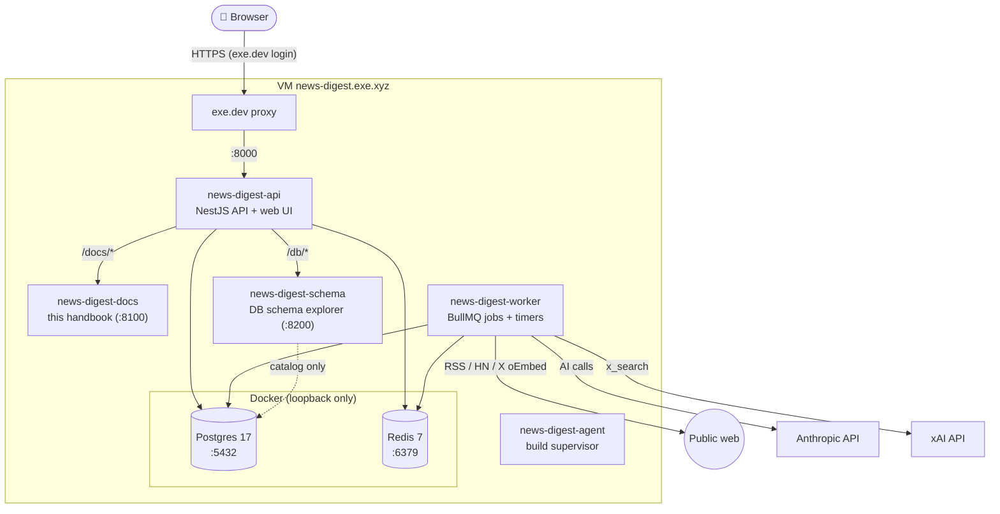

# Stack & runtime

## Tech stack

| Layer         | Choice                                              | Notes                                                  |
| ------------- | --------------------------------------------------- | ------------------------------------------------------ |
| Language      | TypeScript everywhere                               | Node 22, pnpm workspace                                |
| Web UI        | React + Vite single-page app                        | Built to static files, served by the API               |
| API           | NestJS, Domain-Driven Hexagon style                 | REST under `/api/*`, health at `/healthz`              |
| Jobs          | BullMQ on Redis                                     | Separate **worker** process                            |
| Database      | PostgreSQL 17, raw SQL via `pg`                     | Plain SQL migrations in `migrations/` (ORM is planned) |
| Shared types  | Zod schemas in `packages/contracts`                 | Validate API input/output in both API and UI           |
| AI (app)      | Anthropic API: Haiku 5.5 triage, Sonnet 5.5 editing | Own workspace with a hard $15/month limit              |
| Social search | xAI API `x_search` (grok-4.3)                       | Prepaid $15, auto top-up off                           |
| Tests         | `node:test` + Testcontainers (Postgres, Redis)      | Fakes and recorded fixtures; no live calls             |
| Quality gates | ESLint, Prettier, dependency-cruiser, tsc           | All run by `pnpm check`                                |

## Where it runs

One exe.dev VM. App processes are systemd **user** services. Postgres and
Redis run in Docker, reachable only from the VM itself.

> [!NOTE]
> The **API** and the **worker** are separate processes running the same code
> base. The API answers the UI. The worker does everything on a timer or
> queue: collecting, verifying posts and generating editions. The docs and
> schema tools are small separate services, listening only on the VM's
> loopback. The API forwards `/docs/` and `/db/` to them.

## Configuration and secrets

- Secrets (API keys) live only in `~/.config/news-digest/env` on the VM
  (mode 600). They are never committed. The API and worker load this file.
- Non-secret settings (topics, schedule, budgets) live in the database and
  are edited in the app.
- Service definitions are tracked in `ops/services/*.service`.
