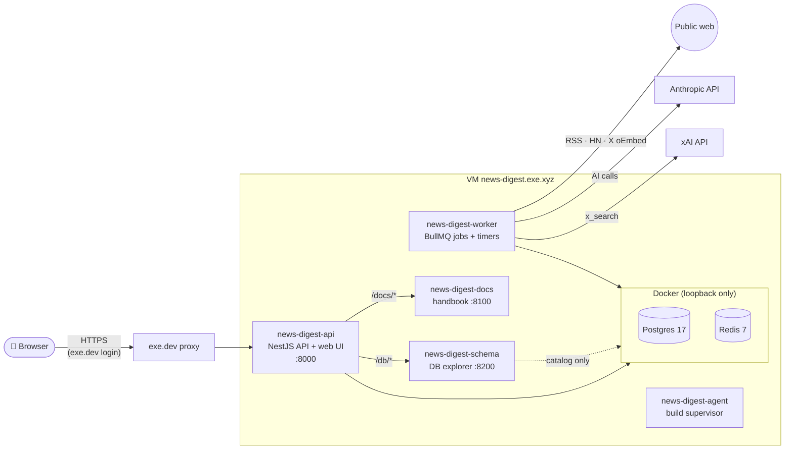

# Stack & runtime

## Tech stack

| Layer         | Choice                                              | Notes                                                                                                                         |
| ------------- | --------------------------------------------------- | ----------------------------------------------------------------------------------------------------------------------------- |
| Language      | TypeScript everywhere                               | Node 22, pnpm workspace                                                                                                       |
| Web UI        | React + Vite SPA; TanStack Router and Query         | Built to static files, served by the API                                                                                      |
| API           | NestJS, Domain-Driven Hexagon style                 | REST under `/api/*`, health at `/healthz`                                                                                     |
| Jobs          | BullMQ on Redis                                     | Separate **worker** process                                                                                                   |
| Database      | PostgreSQL 17 with Drizzle ORM                      | Application data access uses Drizzle; [database boundaries and migration policy](../../decisions/0003-drizzle-data-access.md) |
| Shared types  | Zod schemas in `packages/contracts`                 | Validate API input/output in both API and UI                                                                                  |
| AI (app)      | Anthropic API: Haiku 5.5 triage, Sonnet 5.5 editing | Own workspace with a hard $15/month limit                                                                                     |
| Social search | xAI API `x_search` (grok-4.3)                       | Prepaid $15, auto top-up off                                                                                                  |
| Tests         | `node:test` + Testcontainers (Postgres, Redis)      | Fakes and recorded fixtures; no live calls                                                                                    |
| Quality gates | ESLint, Prettier, dependency-cruiser, tsc           | All run by `pnpm check`                                                                                                       |

The SPA bundles Inter locally and uses Tailwind v4 with shadcn/ui button
primitives. Light and dark themes follow the system setting until the header
toggle saves a preference in the browser. Open tabs share that preference.
Existing layouts remain in a legacy CSS layer.

Topic settings, incoming articles and connection health share a validated browser
cache. Saved editions and each history page use the same cache, with separate
entries for the latest edition and each saved ID. Edition and archive requests use
reader-only payloads; stories and posts show content without selection diagnostics. Navigation reuses fresh data; saving settings refreshes affected data. Status shares the cache, refreshes each
minute while open in the app, and retains the last snapshot if a refresh fails.

## Where it runs

One exe.dev VM. App processes are systemd **user** services. Postgres and
Redis run in Docker, reachable only from the VM itself.

> [!NOTE]
> The **API** and the **worker** are separate processes running the same code
> base. The API answers the UI. The worker does everything on a timer or
> queue: collecting, verifying posts and generating editions. The docs and
> schema tools are small separate services, listening only on the VM's
> loopback. The API forwards `/docs/` and `/db/` to them. Local log collection
> uses separate system units and `/logs/`; see [Observability](09-observability.md).

## Configuration and secrets

- Secrets (API keys) live only in `~/.config/news-digest/env` on the VM
  (mode 600). They are never committed. The API and worker load this file.
- `PUBLIC_MODE` is off. Its prepared access stack sets HTTPS, MIME, referrer
  and same-origin framing headers before account handling and authorization.
  The CSP limits base URLs, plugin objects, embedding ancestors and form destinations; images use the app origin or HTTPS sources.
  Document fonts and audio/video use the app origin; social media plays in X frames. Document workers, inline scripts/handlers and eval are blocked. Scripts use the app origin or `https://platform.twitter.com`; theme setup is a local file and browser validation uses no generated code.
  Connections use the app origin or `https://syndication.twitter.com`; frames use the app origin or the two X embed hosts.
- Non-secret settings (topics, schedule, budgets) live in the database and
  are edited in the app.
- App service definitions are tracked in `ops/services/*.service`; observability
  units and configuration live in `ops/observability/`.

Health and console startup use a shared Drizzle connectivity probe. ESLint blocks
runtime PostgreSQL driver imports and direct query calls outside the shared
database library; adapters and public facades may still import connection types.
The owner console retains its SQL helper. Historical SQL migrations still create
and seed the database. A committed Drizzle baseline matches their resulting
schema; offline checks require zero differences.
The migration runner applies historical SQL first, then generated migrations in
journal order, under one transaction and lock. Both use the existing migration
ledger; generated filenames have a `drizzle/` prefix. A failed run rolls back
all its changes. For a staged rollout, `MIGRATE_THROUGH=<journal-tag> pnpm migrate`
stops after that exact generated migration; an unknown tag rolls back the run.
Without it, all pending migrations apply. The baseline makes no schema or content changes.

Reader endpoints `/api/editions/latest` and `/api/editions/:id` return saved
content without scores, selection reasons, model details or candidate counts.
`/api/editions?offset=0` lists 20 saved editions per page with dates, topic names and a
next-page flag, excluding generation methods. Saved editions carry a scheduled,
manual or test kind and a publication timestamp; scheduled saves publish immediately,
manual saves stay private and tests cannot publish. `READER_PUBLISHED_ONLY=1`
limits reader endpoints to published editions and is enabled. Latest and history
responses use `no-store`. Prepared public mode allows a browser to reuse a published
edition ID for one hour in its private cache; other ID reads use `no-store`. The browser uses these reader
endpoints for both edition content and history. Stories use compact cards in a
672 px column, with expandable grouped articles. Desktop contents follow the
current topic and story; mobile uses topic chips and a contents sheet. Story
links retain their hash when a saved edition is reopened. Saved items’ View edition
links jump directly to the bookmarked story or post. The reader makes no operational API requests. Management starts with the operations overview at `/admin`. Shared desktop/mobile
navigation opens Editions, Sources, Topics, Schedule, Spend and Tools. These
dedicated pages replace the old combined management screen.

Prepared public routing admits the deployed theme script and built JavaScript/CSS/WOFF2 files by exact path; restart to refresh the list.

## Admin identity

- `GET /api/me` returns `{ isAdmin }` with caching disabled.
- `/admin` and `/api/admin` paths return 404 unless `X-ExeDev-Email`
  exactly matches an entry in the comma-separated `ADMIN_EMAILS` setting.
- Direct VM scripts can send the `ADMIN_LOCAL_TOKEN` header, matching the
  secret of the same name. This requires a loopback socket and no forwarding
  headers; loopback alone grants no access. Missing settings deny access.
- Operational APIs under `/api/admin` serve topics, profile, status, content
  and digest previews. Old API paths are removed. The same gate protects
  `/docs`, `/db`, `/grafana`, `/logs`, `/metrics` and `/queues`. See the [access decision](../../decisions/2026-11-05-admin-access.md).
