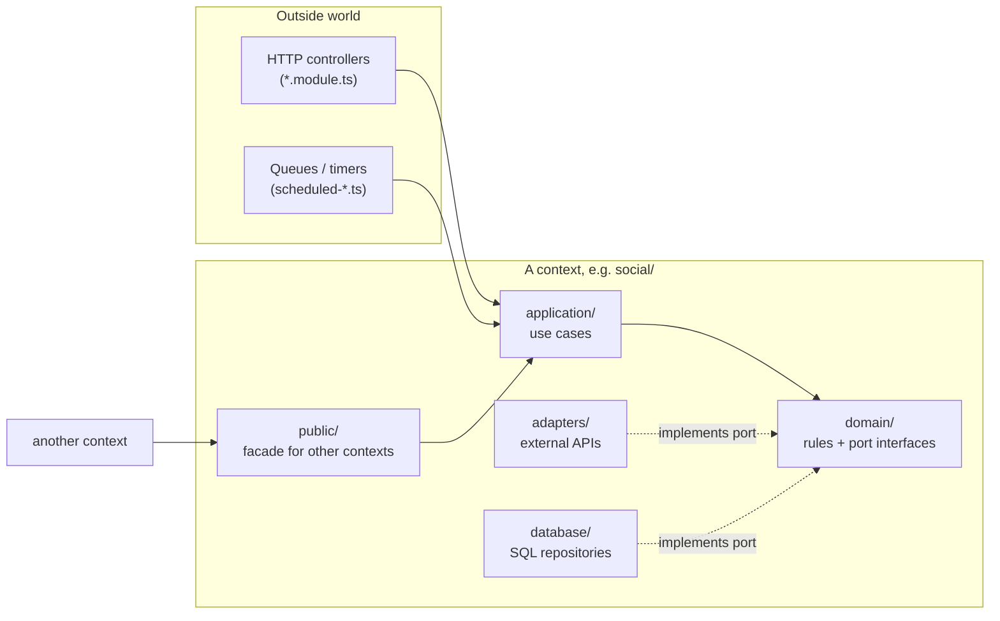

# Code structure

## Repository map

```text
news-digest/
├── apps/
│   ├── api/              NestJS API + worker (all backend code)
│   │   ├── src/
│   │   │   ├── main.ts           API process entry
│   │   │   ├── worker.ts         worker process entry
│   │   │   ├── scheduled-*.ts    timers/queues for editions and social
│   │   │   ├── modules/<context> one folder per business area (below)
│   │   │   └── libs/             shared plumbing: DB, HTTP client, Result
│   │   ├── test/                 unit + integration tests
│   │   └── scripts/              one-off evaluations and reports
│   ├── web/              React SPA (edition view, settings, status)
│   ├── docs-site/        serves this handbook
│   └── schema-explorer/  live DB schema diagram
├── packages/contracts/   Zod schemas shared by API and web
├── migrations/           numbered SQL files, applied in order
├── scripts/              smoke checks and test runners
├── docs/                 handbook, decisions, reference notes
├── ops/                  systemd units, VM setup, agent harness
└── MISSION.md · STEERING.md · TASKS.md · PROGRESS.md · AGENTS.md   (agent memory)
```

## Business areas (bounded contexts)

| Context      | Owns                                                                         |
| ------------ | ---------------------------------------------------------------------------- |
| `profiles`   | The owner profile and the daily schedule (cron, timezone, coverage window)   |
| `topics`     | Topics, their guidance and budgets, and which sources feed them              |
| `ingestion`  | Fetching RSS/HN, normalizing and deduplicating articles, extracting X links  |
| `social`     | Finding X posts (free and paid), verifying them, social budgets              |
| `curation`   | AI: triage and editor prompts, model calls, the spend ledger and budgets     |
| `digests`    | Building an edition: candidates, ranking, calling curation, saving snapshots |
| `operations` | The Status page: source health, queues, coverage and spend                   |

## Inside a context: hexagonal layers

Each context uses the same folders. Dependencies point **inward**: domain
code knows nothing about NestJS, SQL or HTTP.



| Folder         | Holds                                                           |
| -------------- | --------------------------------------------------------------- |
| `domain/`      | Pure rules and types, plus **ports** (interfaces for I/O)       |
| `application/` | Use cases that orchestrate domain rules through ports           |
| `adapters/`    | Port implementations for external systems (Anthropic, xAI, RSS) |
| `database/`    | Postgres ports implemented with Drizzle ORM                     |
| `public/`      | The only entry point other contexts may import                  |

## Enforced rules

`pnpm boundaries` (dependency-cruiser, part of `pnpm check`) fails the build
when:

- **domain is impure:** a `domain/` file imports a framework, database or
  network library;
- **cross-context reach-in:** a context imports another context's internals
  instead of its `public/` folder.

Application storage queries and transactions use Drizzle ORM in `database/`
adapters and shared `libs/db` plumbing. Adapters map stored rows into domain
values. Lint and dependency checks keep the ORM outside application and domain
layers, and prohibit direct PostgreSQL queries outside `libs/db`. PostgreSQL
JSON and advisory-lock expressions remain typed SQL inside these adapters.
Migration-file execution and the owner's console SQL helper stay in `libs/db`.
