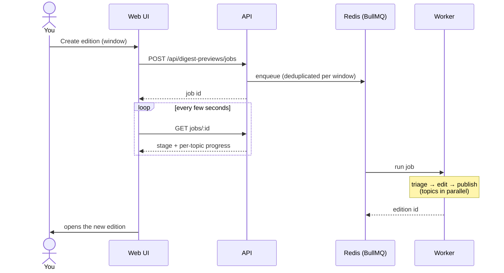

# Jobs & schedules

All background work runs in the **worker** process. It uses BullMQ queues on
Redis (retried, visible on the Status page) plus a few in-process timers.

## What runs when

| Job                     | Queue / mechanism    | Runs                              | Does                                                         |
| ----------------------- | -------------------- | --------------------------------- | ------------------------------------------------------------ |
| Collect a source        | `ingestion`          | Every 30 min per connected source | Fetch an RSS feed or HN, store new articles                  |
| Free social collection  | `social-collection`  | Hourly                            | Scan news rivers and article pages for X links, verify posts |
| Scheduled X search      | timer (every minute) | 5–30 min before the edition       | One paid xAI search per topic, then verify the posts found   |
| Scheduled edition       | `digest-generation`  | Daily cron, default 07:00 PT      | Build and publish the edition                                |
| On-demand edition       | `digest-generation`  | When you click "create edition"   | Same pipeline, for any time window, with live progress       |
| Budget/schedule refresh | timer (every 10 s)   | Continuous                        | Sync the cron from settings; manage the AI reserve           |
| Heartbeat               | `operations`         | Every minute                      | Proves the worker is alive (shown on Status)                 |

## A normal day (times in Pacific)

```mermaid
gantt
  dateFormat HH:mm
  axisFormat %H:%M
  todayMarker off
  section Articles
  Every 30 min         :active, 00:00, 24h
  section Free X
  Hourly               :active, 00:00, 24h
  section Paid X
  Searches before edition :crit, 06:30, 25m
  section Edition
  Scheduled edition    :milestone, 07:00, 0m
  section AI budget
  New UTC budget day   :milestone, 16:00, 0m
```

The AI budget day follows UTC, so it resets at 16:00 Pacific (17:00 in
summer). Until the morning edition has run, part of the day's budget is held
back for it (see [AI & budgets](06-ai-and-budgets.md)).

## How an on-demand edition flows

## Reliability rules

- **Retries:** collection and edition jobs retry 3 times with exponential
  backoff. Every job keeps a bounded history visible on Status.
- **Missed runs:** if the worker was down, a scheduled edition still runs when
  it comes back, unless it is more than 6 hours late. Then it is skipped with
  a reason rather than publishing a stale edition.
- **Idempotency:** each scheduled slot has a unique key, so a retry can never
  publish two editions for the same morning.

Scheduled X discovery searches the available part of the edition's coverage
window, up to the latest 24 hours. Date-only search bounds include the current
partial UTC day; the prompt supplies exact start/end times and asks for recent
strong posts. Posts still pass verified timestamp and relevance gates before
publication. Discovery stops at search time, so posts arriving in the remaining
5–30 minutes before publication may be missed.
