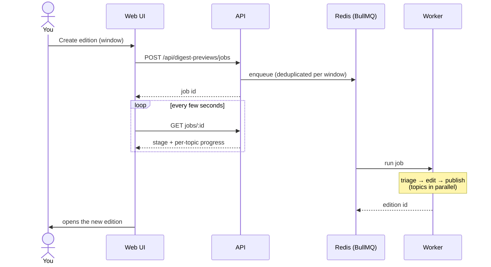

# Jobs & schedules

App background work runs in the **worker** process. It uses BullMQ queues on
Redis (retried, visible on the Status page) plus a few in-process timers.

## What runs when

| Job                     | Queue / mechanism    | Runs                              | Does                                                                                                                                          |
| ----------------------- | -------------------- | --------------------------------- | --------------------------------------------------------------------------------------------------------------------------------------------- |
| Collect a source        | `ingestion`          | Every 30 min per connected source | Fetch an RSS feed or HN, store new articles                                                                                                   |
| Bluesky collection      | `social-collection`  | Hourly                            | Up to four enabled topics, one open query each; store observed posts/counts; no AI calls; one session refresh on token expiry, no job retries |
| Free social collection  | `social-collection`  | Hourly                            | Scan news rivers and article pages for X links, verify posts                                                                                  |
| Scheduled X search      | timer (every minute) | 5–30 min before the edition       | Open-topic xAI search, verification, then capped low-yield followup                                                                           |
| Scheduled edition       | `digest-generation`  | Daily cron, default 07:00 PT      | Build and publish the edition                                                                                                                 |
| On-demand edition       | `digest-generation`  | When you click "create edition"   | Same pipeline, for any time window, with live progress                                                                                        |
| Budget/schedule refresh | timer (every 10 s)   | Continuous                        | Sync the cron from settings; manage the AI reserve                                                                                            |
| Heartbeat               | `operations`         | Every minute                      | Proves the worker is alive (shown on Status)                                                                                                  |

Private [database backups](10-backups.md) use separate systemd user timers:
nightly at 02:20 UTC, with a restore check Sunday at 03:20 UTC.

The worker also has an optional incremental article-triage timer, disabled by
default. Enabling `LLM_INCREMENTAL_TRIAGE_ENABLED=1` requires the scheduled
budget reserve, an Anthropic API key and an absolute
`LLM_INCREMENTAL_TRIAGE_EVIDENCE_DIRECTORY`. Missing or blank credentials
stop worker startup when this setting is enabled.
Once a minute it checks the saved schedule and enabled topics, rotates through
one topic and scores at most 25 uncached articles. It uses the normal budget
without access to the scheduled reserve and starts no new scoring within two
hours of publication. It saves cache-write evidence for measuring unused work. Shutdown drains active work
before closing its database connections. It remains off pending the Nov 4
edition review; no daytime scoring is running.

## A normal day (times in Pacific)

```mermaid
gantt
  dateFormat HH:mm
  axisFormat %H:%M
  todayMarker off
  section Articles
  Every 30 min         :active, 00:00, 24h
  section Free X
  Hourly               :active, 00:00, 24h
  section Paid X
  Searches before edition :crit, 06:30, 25m
  section Edition
  Scheduled edition    :milestone, 07:00, 0m
  section AI budget
  New UTC budget day   :milestone, 16:00, 0m
```

The AI budget day follows UTC, so it resets at 16:00 Pacific (17:00 in
summer). Until the morning edition has run, part of the day's budget is held
back for it (see [AI & budgets](06-ai-and-budgets.md)).

## How an on-demand edition flows

## Reliability rules

- **Retries:** collection and edition jobs retry 3 times with exponential
  backoff. Every job keeps a bounded history visible on Status.
- **Missed runs:** if the worker was down, a scheduled edition still runs when
  it comes back, unless it is more than 6 hours late. Then it is skipped with
  a reason rather than publishing a stale edition.
- **Idempotency:** each scheduled slot has a unique key, so a retry can never
  publish two editions for the same morning.
- **Progress connection:** a status request times out after 15 seconds. The
  page reconnects to the same job; generation continues in the worker.

Scheduled X discovery searches the available part of the edition's coverage
window, up to the latest 24 hours. Date-only search bounds include the current
partial UTC day; the prompt supplies exact start/end times and asks for recent
strong posts. Posts still pass verified timestamp and relevance gates before
publication. Discovery stops at search time, so posts arriving in the remaining
5–30 minutes before publication may be missed.

The worker's `X_FIXED_SEARCH_ENABLED=1` setting replaces open-topic searches
and optional followups with fixed A/B discovery. It defaults off. A searches
reactions to the top 2–3 ranked stories; B searches topic trends using stored
thresholds and exclusions. A runs first; quiet-topic B calls lose budget slots
first. Both use the same spend caps, verification and durable daily admission.
Enable only after the experiment decision is acknowledged in STEERING.
