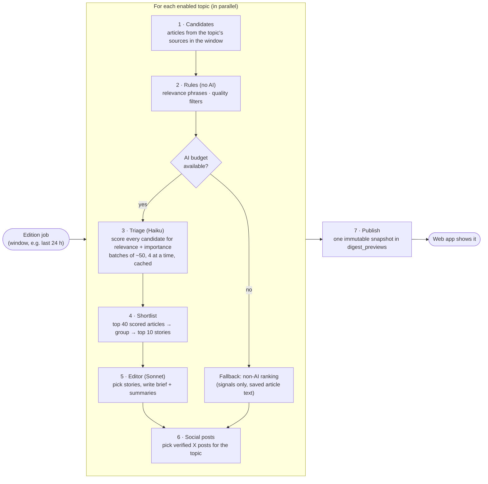

# Edition pipeline

An edition is built the same way whether it's scheduled or on demand. Topics
are processed **in parallel**. Each topic goes through the steps below, and
the result is saved as one immutable snapshot.

When every article has a triage score but the editor fails, the fallback keeps
the shortlist in importance order and shows source excerpts. Incomplete triage
uses the ordinary relevance and recency fallback. Neither fallback writes a brief.

## The steps in one line each

| Step          | Plain-language purpose                                                                  |
| ------------- | --------------------------------------------------------------------------------------- |
| 1. Candidates | Everything collected for this topic during the window (up to a few hundred items)       |
| 2. Rules      | Drop quality-rule rejections (betting promos, game threads) and excluded topic phrases  |
| 3. Triage     | A cheap model scores each item, so the expensive model sees only the best               |
| 4. Shortlist  | Group up to 40 scored articles, then rank at most 10 stories for the editor             |
| 5. Editor     | A stronger model chooses stories and writes the brief, using only facts in the items    |
| 6. Social     | Choose the topic's posts from verified X posts (see [Social posts](05-social-posts.md)) |
| 7. Publish    | Copy everything shown into a JSON snapshot; a DB trigger forbids later edits            |

## Things worth knowing

- **Before article triage:** skip existing quality-rule rejections and explicit
  excluded topic phrases. Missing required phrases still reach AI, which can
  recover relevant news. Candidate totals and quality omissions retain all inputs;
  triage coverage describes only the candidates admitted for scoring.
- **Caching:** triage results are cached per item and prompt, so
  regenerating an edition only pays for new items.
- **Triage throughput:** article and social scoring use batches of up to 50
  candidates and request short event labels and factual explanations. Output
  reservations grow with batch and identifier size. This limits reserved spend;
  actual provider speed and cost are measured from scheduled editions.
- **Graceful degradation:** if triage can't finish within the budget, that
  topic uses non-AI ranking. The edition still publishes, and the snapshot
  records why. Reader stories show the saved article text when no AI summary
  exists, with no mode label. New fallback excerpts stop at a word boundary
  within 600 characters and mark omitted text with an ellipsis. The reader hides a terminal “The post … appeared
  first on …” credit when it matches the story title; saved source text stays intact.
- **Story composition:** the editor keeps separate developments in separate
  stories. Direct follow-ups, reactions and consequences can share a story;
  a shared company or theme alone is insufficient.
- **Validation:** AI output is schema-checked. Stories the model returns that
  aren't backed by a real candidate are rejected.
- **Progress:** on-demand jobs report the stage of each topic (triage →
  editing → publishing) to the UI while they run.
- **Test editions:** admins can POST a past window to
  `/api/admin/digest-previews/tests`. AI editing and paid X search default off;
  stored articles and X/Reddit posts use non-AI ranking by default. Set
  `aiEditing: true` for isolated development-funded editing when `LLM_LIVE=1`.
  Set `paidXSearch: true` for isolated X discovery when `X_SEARCH_LIVE=1`.
  Tests appear only in admin and emit no edition alerts.
  The preview smoke command uses this endpoint, free by default; `LLM_LIVE=1`
  enables development AI and creates one private test edition. The admin form
  also creates private tests, with AI off by default and an explicit AI option.
- **History:** every edition is kept. The UI can browse and reopen any past
  edition by its id.

> [!NOTE]
> Production enabled `LLM_STORY_GROUPING_ENABLED=1` on Nov 4 for the Nov 5
> scheduled edition. The code default remains off; set the switch to `0` to
> disable it. The enabled switch adds a bounded Haiku pass over each topic's
> forty-article scored pool before selecting ten stories for editing, using the ordinary shared budget
> and cache. It groups the same news story, including direct follow-ups,
> reactions and consequences; shared people or themes alone do not qualify.
> Failed, invalid or budget-refused grouping keeps articles separate. Grouped
> articles share one story slot and retain their coverage links without a score
> bonus. Source labels do not establish independent reporting. Same-URL dedupe
> still happens during ingestion; historical editions keep their original coverage.
