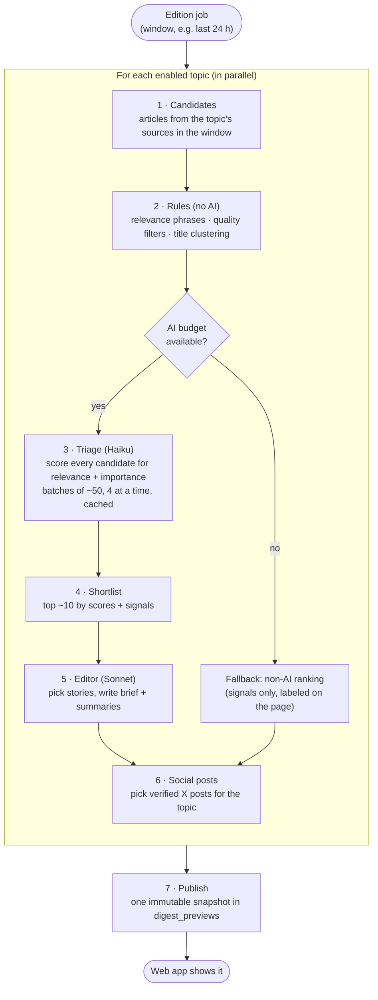

# Edition pipeline

An edition is built the same way whether it's scheduled or on demand. Topics
are processed **in parallel**. Each topic goes through the steps below, and
the result is saved as one immutable snapshot.

## The steps in one line each

| Step          | Plain-language purpose                                                                  |
| ------------- | --------------------------------------------------------------------------------------- |
| 1. Candidates | Everything collected for this topic during the window (up to a few hundred items)       |
| 2. Rules      | Drop clear junk (betting promos, game threads), merge near-identical headlines          |
| 3. Triage     | A cheap model scores each item, so the expensive model sees only the best               |
| 4. Shortlist  | Combine AI scores with signals (recency, number of outlets, HN points)                  |
| 5. Editor     | A stronger model chooses stories and writes the brief, using only facts in the items    |
| 6. Social     | Choose the topic's posts from verified X posts (see [Social posts](05-social-posts.md)) |
| 7. Publish    | Copy everything shown into a JSON snapshot; a DB trigger forbids later edits            |

## Things worth knowing

- **Caching:** triage results are cached per item and prompt, so
  regenerating an edition only pays for new items.
- **Graceful degradation:** if triage can't finish within the budget, that
  topic uses non-AI ranking. The edition still publishes, and the snapshot
  records why.
- **Validation:** AI output is schema-checked. Stories the model returns that
  aren't backed by a real candidate are rejected.
- **Progress:** on-demand jobs report the stage of each topic (triage →
  editing → publishing) to the UI while they run.
- **History:** every edition is kept. The UI can browse and reopen any past
  edition by its id.

> [!NOTE]
> Planned: grouping articles about the same event into one story with "also
> covered by" links (STEERING item 19). Today only near-identical headlines
> are merged.
