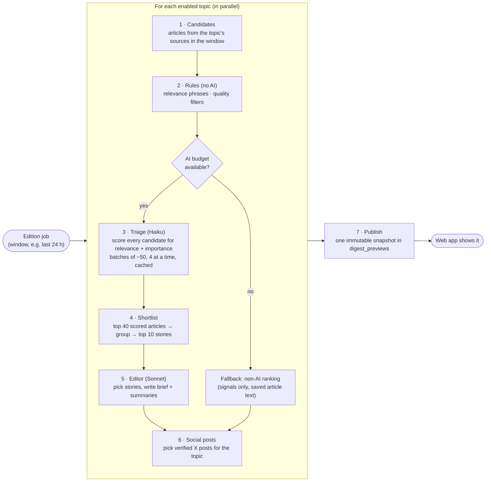

# Edition pipeline

Scheduled and on-demand editions run topics **in parallel** and save one immutable snapshot.
Weekly generation uses saved daily coverage, the shared AI budget and separate immutable storage with retry keys; it requires Sunday’s published daily edition. Public weekly history and detail are at `/api/weekly-editions` and `/api/weekly-editions/:id`, with summaries and daily coverage links. Private profiles stay excluded. Readers open “Week in review” from Past editions, browse weekly history at `/weekly-editions`, and follow saved daily coverage from each summary. Automatic scheduling is still pending.

When every article has a triage score but the editor fails, the fallback keeps
the shortlist in importance order and shows text labelled “Source excerpt” in the reader. Incomplete triage
uses the ordinary relevance and recency fallback. Both omit articles without source
text, so a topic can have fewer stories. Neither fallback writes a brief. All topic editors use concise complete JSON within the same output budget. Negative findings, technical conditions and product limits retain complete source sentences with attribution and qualifications; headlines prefer supported positive facts. Tech research summaries also retain central counterfindings and supplied publication status alongside gains.

Feed excerpts use explicit RSS/Atom article content before descriptions or
summaries, falling back when content is blank. Text stays capped at 1,500
characters, with an ellipsis when shortened and whole words where possible.
Verge ad configuration and GameSpot navigation are removed before excerpting.
Hacker News fetches article/main (including ARIA main), abstract, e-content,
article-template, AsciiDoc document bodies or MediaWiki prose for submissions without text (1,500 characters), excluding footers; scoped GitHub release notes supply paragraphs and changelog lists. Discourse announcements use the opening post, excluding reader replies. Title-matched book chapters supply prose from their introduction, excluding author bios, banners and footnotes. Sectioned magazine pages supply selectable reporting sections, excluding promotion and captions. Minimal documents supply consecutive opening paragraphs after their sole top-level heading. Older blogs can supply consecutive paragraphs after a title-matched column heading, ending at the next section or widget. Blogs with a title-matched heading and explicit article body supply only that body, excluding sibling recent-post lists. When no body prose is available, the page’s own description metadata supplies a short summary (at least 60 characters, capped at 1,500). HN excludes X pages, Nitter mirrors and Reddit from publisher fetching, including redirect destinations.

## The steps in one line each

| Step          | Plain-language purpose                                                                  |
| ------------- | --------------------------------------------------------------------------------------- |
| 1. Candidates | Everything collected for this topic during the window (up to a few hundred items)       |
| 2. Rules      | Drop quality-rule rejections (betting promos, game threads) and excluded topic phrases  |
| 3. Triage     | A cheap model scores each item, so the expensive model sees only the best               |
| 4. Shortlist  | Group up to 40 scored articles, then rank at most 10 stories for the editor             |
| 5. Editor     | A stronger model chooses stories and writes the brief, using only facts in the items    |
| 6. Social     | Choose the topic's posts from verified X posts (see [Social posts](05-social-posts.md)) |
| 7. Publish    | Copy everything shown into a JSON snapshot; a DB trigger forbids later edits            |

## Things worth knowing

- **Before article triage:** skip existing quality-rule rejections and explicit
  excluded topic phrases. Missing required phrases still reach AI, which can
  recover relevant news. Candidate totals and quality omissions retain all inputs;
  triage coverage describes only the candidates admitted for scoring.
- **Caching:** triage results are cached per item and prompt.
- **Triage throughput:** scoring batches contain up to 50 candidates. Output
  reservations grow with batch and identifier size.
- **Graceful degradation:** if triage can't finish within the budget, that
  topic uses non-AI ranking. The edition still publishes, and the snapshot
  records why. Reader stories show the saved article text when no AI summary
  exists, labelled “Source excerpt”. New fallback excerpts stop at a word boundary
  within 600 characters and mark omitted text with an ellipsis; reader excerpts prefer complete sentences.
  The reader hides a terminal “The post … appeared first on …” credit matching the story title; saved text stays intact.
- **Tech story evidence:** each editor candidate includes its representative and up to
  two reports from the same cluster, preferring direct publisher excerpts over
  Google News snippets, with separate publisher names.
  Cited reports are copied into the immutable edition with the same bounded text.
  The optional `TECH_STORY_ADMISSION=1` switch reserves two of the ten editor
  candidates for the highest-importance scored events after successful grouping;
  Enabled on this VM; failed grouping or triage keeps the usual ranking.
  Private snapshots retain editor prompts, unselected reports and grouping inputs/URLs;
  Offline tracing follows saved merges and joint World/U.S. assignments into the destination topic’s editor inputs and selected stories.
  Enabled Tech admission retains reserved, displaced and admitted event IDs
  and reservation scores. Public reader responses omit private review fields.
- **Story composition:** the editor keeps separate developments in separate
  stories. Inputs separate the excerpt’s publisher and URL from coverage labels, which cannot establish reporting attribution. Direct follow-ups, reactions and consequences can share a story;
  a shared company or theme alone is insufficient.
- **Validation:** AI output is schema-checked. Stories the model returns that
  aren't backed by a real candidate are rejected. Rejected story-editor and cross-topic ownership attempts
  keep their input, response and reason in private VM files at
  `~/.local/state/news-digest/rejected-editors/` for replay. The store retains
  at most 100 files, each at most 256 KiB, and removes files over 30 days old
  on the next write. These files are separate from logs and the response cache.
- **Why this:** stories and posts show a collapsed disclosure with the saved editor’s selection reason. Open it to read why that item was picked. Items without an editor reason show no disclosure. Ranking scores and operational reasons stay private.
- **Progress:** on-demand jobs report the stage of each topic (triage →
  editing → publishing) to the UI while they run.
- **Test editions:** admins can POST a past window to
  `/api/admin/digest-previews/tests`. AI editing and paid X search default off;
  stored articles and X/Reddit posts use non-AI ranking by default. Set
  `aiEditing: true` for isolated development-funded editing when `LLM_LIVE=1`.
  Set `paidXSearch: true` for isolated X discovery when `X_SEARCH_LIVE=1`.
  Tests appear only in admin and emit no edition alerts.
  The preview smoke command uses this endpoint, free by default; `LLM_LIVE=1`
  enables development AI and creates one private test edition. The admin form
  also creates private tests, with AI editing and paid X search off by default
  and independent opt-ins using development funds. The form links to remaining
  allowances and explains when a paid option is disabled on the server.
- **History:** every edition is kept. The UI can browse and reopen any past
  edition by its id.
- **Developing stories:** saved links show “Developing”, the edition count and
  “Earlier coverage” to the previous story. Matching is still in offline review;
  scheduled generation does not yet save these links.

> [!NOTE]
> Production enabled `LLM_STORY_GROUPING_ENABLED=1` on Nov 4 for the Nov 5
> scheduled edition. The code default remains off; set the switch to `0` to
> disable it. The enabled switch adds a bounded Haiku pass over each topic's
> forty-article scored pool before selecting ten stories for editing, using the ordinary shared budget
> and cache. It groups the same news story, including direct follow-ups,
> reactions and consequences; shared people or themes alone do not qualify.
> For World and U.S., both scopes share up to 200 recent reports for triage.
> The top 20 reports per scope enter one joint event-grouping and ownership
> pass; each event goes to one topic before its top ten stories are edited.
> Unavailable ownership withholds both story sections and labels the reason.
> Other topics keep articles separate when grouping fails or is refused. Grouped
> articles share one story slot and retain their coverage links without a score
> bonus. Source labels do not establish independent reporting. Same-URL dedupe
> still happens during ingestion; historical editions keep their original coverage.
