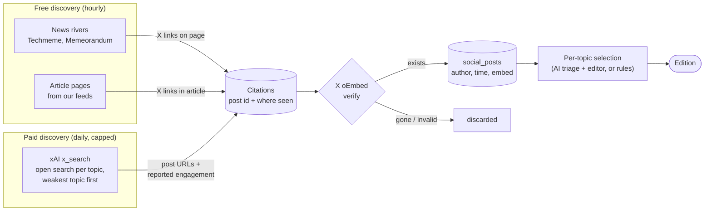

# Social posts

Each topic shows a few social posts next to its stories: X posts, the #1
source, and Bluesky posts. Reddit is parked.

## How X posts are found

There are two ways in. Both feed one pool of **candidate posts**, and a post
is only shown after X's official embed service confirms it exists.

| Path                    | Cost                   | Strength                                | Weakness                                          |
| ----------------------- | ---------------------- | --------------------------------------- | ------------------------------------------------- |
| Free (rivers, articles) | $0                     | Not tied to any account list            | Lags: a post appears only once media embeds it    |
| Paid (xAI search)       | $0.026–$0.038 on Nov 3 | Searches X directly, before the edition | Reported engagement is not independently verified |

- **Open search:** 5–30 minutes before the edition, one search per topic with
  no account restriction, weakest topic first. It asks for original, engaging
  posts in the edition window.
- **Follow-up:** a topic with fewer than three new verified posts can get one
  more search. It looks for reactions to a top story first, otherwise it
  searches the topic's curated accounts.
- **Curated accounts:** edit them in **Manage topics → Edit → X accounts**
  (up to 20 per topic). They only feed the follow-up search. The reviewed
  choices are recorded in [Sources](../../SOURCES.md).
- **Reports:** `scripts/report-x-discovery.ts` (one day) and
  `report-x-week.ts` (seven days) show spend and new verified posts by topic
  and search type, including posts from authors outside the account lists.

X triage receives the author, reported likes when available (labelled as
unverified hints), and whether the verified text includes a media link. Missing
counts and media stay unknown; a link supplies no evidence of media contents.

## How Bluesky posts are found

- **Collected hourly** through the official API, using the owner's app
  password: one search per enabled topic, up to 50 posts each. The topic editor
  offers a dedicated query; blank uses the first news query, include phrase,
  or topic name. If the login
  is missing, collection is skipped.
- **Counts are snapshots:** each observation is stored with its likes,
  reposts, replies and time. An edition sees the counts as they were at its
  cutoff.
- **At edition time:** AI triage screens up to 50 candidates, then the editor
  fills the topic's remaining post slots (X picks come first). It skips
  posts that repeat something already picked from X.
- **Cards** are drawn by the app, with no Bluesky script: full text, author,
  time, counts and images. Videos link to the post.
- **Controls:** `BLUESKY_EDITIONS_ENABLED=0` turns inclusion off.
  `scripts/report-bluesky-coverage.ts` shows stored posts per topic.

## Verification and safety

- **Official only:** X posts are confirmed with X's public **oEmbed**
  endpoint and rendered with X's official embed. Bluesky uses the official
  API. The app never scrapes either site.
- **Engagement numbers are hints, not facts.** xAI's counts are stored as
  "reported by xAI", and Bluesky's as timestamped API counts. The editor
  sees them, but relevance and distinct content come first.
- **Execution:** requests require the X search tool before a text answer.
- **Experiment retries:** a timeout or failed/unconfirmed search with no fetched
  posts gets one separately admitted retry. Completed empty searches never retry.
  Timeouts retain their hold; returned usage settles before retrying.
- **Fixed scheduler:** stays off. Its ledger can admit one linked retry for an
  uncertain timeout or unconfirmed zero-post search, preserving holds and caps.
  Completed empty searches and historical unknown execution cannot qualify.
  The scheduler does not dispatch these retries yet.
- **Accounting:** calls allow 120 seconds. Returned token usage settles the actual
  cost; missing fetched-post/profile counters count as zero. No-response timeouts
  keep their reservation. Saved experiment responses can settle holds offline;
  hash-linked journal additions preserve the original request entries.
- **Search tracing:** each paid call stores the actual search functions and
  inputs returned by xAI alongside its cost. Settlement also saves whether
  search execution was confirmed, including completed empty searches. Older calls
  keep unknown execution.
- **Budget:** paid X search has its own ledger and caps: $0.40/day and
  $12/month. The xAI account is prepaid ($15), so it can't overspend even if
  the app is wrong. Bluesky is free; its AI triage and editing use the
  normal AI budget.

> [!NOTE]
> The replacement schedule is off pending the [experiment decision](../../x-search-plan.md).
> It prepares one 16-result viral search per topic, with fresh keywords from
> the topic description and code-built time/like filters. Stored trending
> thresholds supply its minimum likes; edit minimum likes and exclusions in
> `/admin/topics/:id`. Every query excludes giveaways; saving leaves the schedule off.
> Four $0.10 reservations fit the $0.40 daily cap. Current production is unchanged.

## Other platforms

| Platform | Status                                                                                                                                   |
| -------- | ---------------------------------------------------------------------------------------------------------------------------------------- |
| Reddit   | **Parked.** Built, but Reddit blocks public access and ends RSS on Nov 13. The only way back is the official API with owner credentials. |
| YouTube  | **Deferred** by the owner.                                                                                                               |
