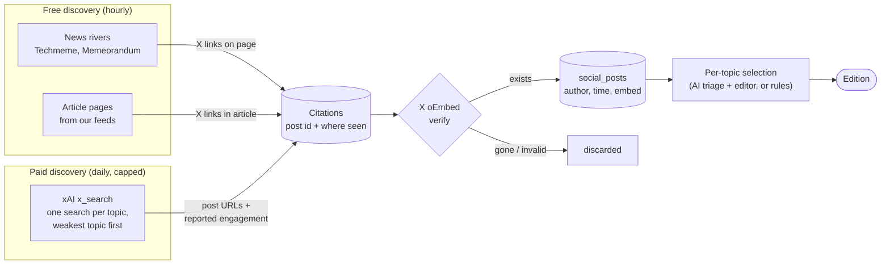

# Social posts

Each topic shows a few social posts next to its stories. Today these are X
posts only. X is the owner's #1 social source, Reddit is parked, and Bluesky is
planned.

## How X posts are found

There are two ways in. Both feed one pool of **candidate posts**, and a post
is only shown after X's official embed service confirms it exists.

| Path                    | Cost                    | Strength                                | Weakness                                       |
| ----------------------- | ----------------------- | --------------------------------------- | ---------------------------------------------- |
| Free (rivers, articles) | $0                      | Not tied to any account list            | Lags: a post appears only once media embeds it |
| Paid (xAI search)       | ~$0.02 per search today | Searches X directly, before the edition | Currently limited to curated accounts          |

> [!IMPORTANT]
> **In progress (STEERING item 16):** open X search with no account
> restriction, per topic plus reactions to the day's top stories, ranked by
> engagement and velocity. Account-list search becomes a secondary input.
> The worker dependencies are connected, but production keeps account-list
> searches until the first scheduled run is measured and acknowledged.

## Verification and safety

- **Official only:** posts are confirmed with X's public **oEmbed** endpoint,
  and the page renders X's official embed. The app never scrapes x.com.
- **Engagement numbers** from xAI are stored as "reported by xAI", not as
  verified facts.
- **Budget:** paid search has its own ledger and caps: $0.40/day and
  $12/month. The xAI account is prepaid ($15), so it can't overspend even if
  the app is wrong.

## Other platforms

| Platform | Status                                                                                                                                   |
| -------- | ---------------------------------------------------------------------------------------------------------------------------------------- |
| Reddit   | **Parked.** Built, but Reddit blocks public access and ends RSS on Nov 13. The only way back is the official API with owner credentials. |
| Bluesky  | **Planned** (STEERING item 18): official public API, open topic search first.                                                            |
| YouTube  | **Deferred** by the owner.                                                                                                               |
