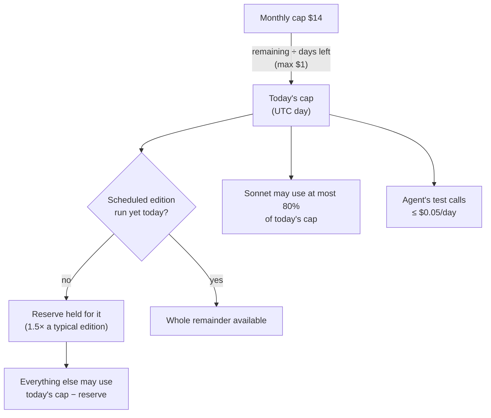
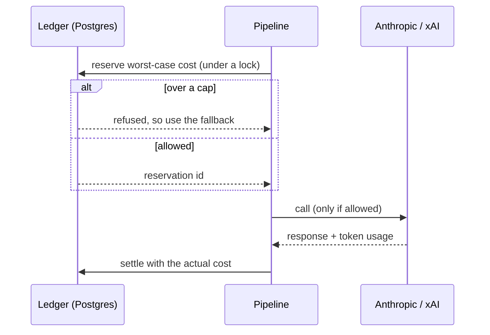

# AI & budgets

The app makes two kinds of paid calls, each with its own provider, ledger and
caps. In both cases, **the provider enforces the hard limit**, so a bug in
the app can never overspend.

| Purpose                  | Provider / model                                   | Hard limit (provider)            | App-side caps                        |
| ------------------------ | -------------------------------------------------- | -------------------------------- | ------------------------------------ |
| Edition triage + editing | Anthropic: Haiku 5.5 (triage), Sonnet 5.5 (editor) | Workspace limit **$15/month**    | $14/month, spread per day (≤ $1/day) |
| X search                 | xAI: `x_search` with grok-4.3                      | Prepaid **$15**, auto top-up off | $0.40/day, $12/month                 |

> [!WARNING]
> The coding agent runs on the owner's ChatGPT subscription, which is a
> separate thing. App traffic must never use that subscription.

## How the Anthropic budget is split

- **Daily cap** = what's left of the month divided by the days left, at most
  $1. Unspent money rolls forward.
- **Reserve:** until the morning edition runs, manual editions and tests
  can't eat into its share. The UI says when a manual run is limited by this.
- **Background triage:** its prepared entry point is disabled by default
  (`LLM_INCREMENTAL_TRIAGE_ENABLED=0`). When enabled, the worker checks once
  a minute, rotates topics and prepares at most 25 pending articles per pass,
  stopping two hours before publication. It requires reserve protection, shares
  the daily ledger and item cache, clears scheduled-edition privileges, and
  leaves refused items for the edition. Without an explicit reserve amount or
  a measured complete AI edition, the reserve protects the whole daily cap
  until the scheduled run finishes;
  background work then has no allowance before publication.
- **Model split:** Sonnet (the expensive editor) is capped at 80% of the day,
  leaving room for Haiku triage.

## Every call goes through a ledger

Spending is enforced before calling, not discovered afterwards.

- **Reserve, then settle.** Concurrent jobs can't race past a cap, because
  reservations and caps are checked under one database lock.
- **Uncertain calls stay charged.** A timeout or unknown error keeps the full
  reservation, so spend is never undercounted.
- **Provider refusals** (limit reached, credits depleted) are recorded and
  stop further calls until the next period.
- **Visibility:** the Status page shows today's and this month's spend by
  purpose, plus the reserve.

Tables: `llm_calls`, `llm_cache`, `scheduled_ai_budget_days`,
`x_discovery_calls` (see [Data model](07-data-model.md)).

## Development allowance storage

- Separate development tables hold lifetime allowances: Anthropic $5 and xAI $2.
- Reservations persist until confirmed billing replaces the hold; admission stops
  at 75% of the allowance and never resets by date.
- A separate Anthropic runtime requires `LLM_LIVE=1`, uses fixed Haiku/Sonnet
  pricing and never retries calls. A separate direct-xAI runtime requires
  `X_SEARCH_LIVE=1`, holds $0.40 before each call and settles all reported token
  and fetched-item costs at fixed prices without retries.
- The Anthropic smoke command uses one development-funded Haiku call and
  verifies durable replay suppression without production accounting.
- Admin test editions accept `aiEditing: true` through the isolated Anthropic
  runtime. Paid X search remains unavailable.
- Free admin test editions reuse stored content without provider calls; existing
  manual generations still use production accounting.
