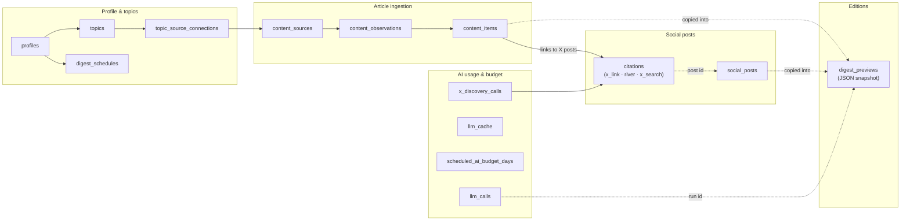
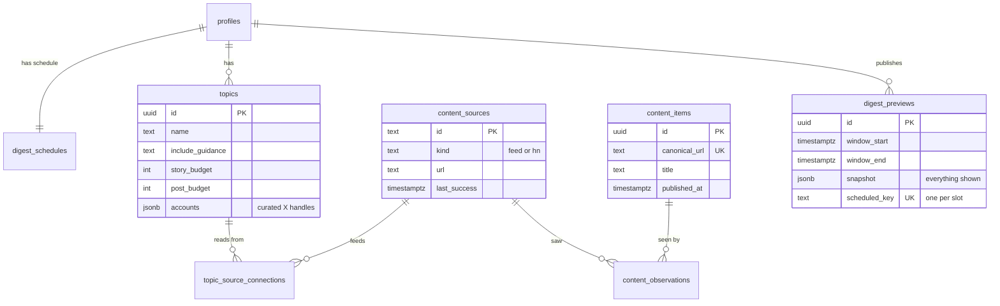
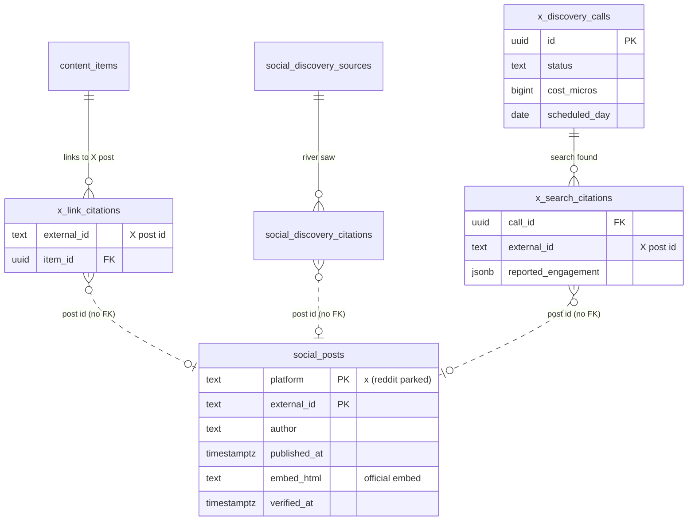

# Data model

Postgres holds settings, content, accounting and private reader tables. Most of the app's state is
simple: settings, collected content, ledgers, and editions as immutable
snapshots.

> [!NOTE]
> Public mode exposes the shared topic settings through an explicit field allowlist;
> topic changes still require an admin. The public source catalog shows publisher
> origins; configured feed paths stay private. Article reads also expose publisher
> origins, and source health exposes counts, timings and an error flag. Stored failure
> text stays private. Private mode retains its existing readers.
>
> `SYSTEM_OWNERSHIP=1` uses the system schedule, shared topics and system-scoped
> editions and job records. Writes preserve default-profile ownership and update
> both settings tables atomically, so turning the flag off restores profile reads.
> The additive migrations retain all existing ownership and foreign keys.
> See the [rollout plan](../../public-access-plan.md).

> [!NOTE]
> Prepared admin-write admission storage records actor, method, path and time.
> Its prepared public policy awaits storage before running an admin write.
> A prepared database boundary commits admission and mutation together.
> A prepared source toggle uses this boundary and returns changed, unchanged
> or not-found. Missing sources leave no admission record. Its prepared HTTP
> boundary checks a bounded request and fresh admin before calling the writer.
> The default-off public runtime routes source toggles, topic toggles and complete
> topic ordering through this boundary. Changes and changed/unchanged outcomes
> commit together; stale topic catalogs leave no admission or ordering change.
> Null outcomes describe admission only, including rows predating migration 0019.
> Deleting an account preserves its private administrative history.
>
> Reader accounts use independent identities, hashed sessions and single-use
> login challenges scoped to the requesting client address. Invite-only sign-in uses a private stand-in mailbox; no
> email is sent. `/account/login` exchanges a code for a secure session cookie.
> The account panel shows sync status, sign-out and confirmed account deletion.
> Admins can issue one-time friend links and revoke a reader’s sessions;
> issuance and revocation write private audit records. Saved topics and bookmarks
> sync between signed-in devices. Deletion removes personal settings and sessions.
> The VM stays private and public mode remains disabled. See the
> [account rollout](../../account-activation.md).

Reader source rows use saved publisher names when available, alongside discovery
provenance; each link still opens its saved report URL. Unknown publishers retain
the discovery label.

Articles can retain a publisher name and URL supplied by structured RSS metadata,
separately from the feed that discovered them. Missing metadata stays unknown;
a later observation without metadata preserves previously collected evidence.
New edition snapshots retain this evidence for each report, including extra
editor citations. Historical snapshots keep their original unknown attribution.

> [!TIP]
> For tables, columns, keys and relationships, open the live
> **[DB schema explorer](https://news-digest.exe.xyz/db/)**. It reads the
> live catalog through a dedicated password-authenticated role with no
> application-row access. It shows structure only: definitions, activity, sizes
> and metadata notes stay out of the response. Startup requires an explicit
> `SCHEMA_EXPLORER_DATABASE_URL`; missing credentials stop the service.

## The areas and how they connect

Solid arrows are foreign keys or ownership. Dotted arrows are references
without a foreign key: values copied into a snapshot, or ids shared by
convention.

## Core entities

## Social posts

Dotted lines: the citation tables point at `social_posts` by X post id, with no
foreign key, because a citation is stored before the post is verified.

## Patterns to know

- **Snapshots, not joins, for editions.** `digest_previews.snapshot` holds a
  copy of every story, summary and post shown. Old editions stay readable even
  if articles or settings change. A trigger forbids UPDATE and DELETE.
- **Private reader storage.** Account tables hold identities, login challenges,
  sessions, friend links, saved choices and admin audit records. Operational
  reader roles and PUBLIC have no access. Migrations explicitly revoke account
  privileges from all five tool readers, including catalog and prepared export readers. Admin history retains actor IDs and
  recipient emails after account deletion; sessions and personal settings are removed. Invite-only accounts use these tables;
  the [account rollout](../../account-activation.md) describes operation and rollback.
- **Ledgers for money.** `llm_calls` and `x_discovery_calls` record a
  reservation before each paid call and the actual cost after it. Budgets are
  computed from these tables.
- **Dedup by URL.** An article is stored once (`canonical_url` is unique) even
  when several sources publish it. `content_observations` records who saw it.
  Feed images prefer media metadata, then an opening article-content figure, then Gematsu’s opening publisher-hosted description image, then an HTTPS raster-image enclosure.
  Feed excerpts prefer article content, then summaries; opening photo captions
  and self-linked publisher footers are omitted, along with named GameSpot/Yoast contents blocks and Destructoid screenshot-only credits. PlayStation podcast excerpts omit the opening email/subscription promotion; Verge purchase widgets are omitted while reported prices remain. Push Square teaser self-links become an omission marker. The 1,500-character cap marks cuts with “…”.
  Google News descriptions repeating only a headline and publisher stay blank. A blank incoming excerpt keeps the saved text; a nonblank excerpt updates it.
- **Money is integer micro-dollars** (`*_micros`, 1,000,000 = $1) to avoid
  rounding errors.
- **Migrations** start with the historical SQL in `migrations/`, then the
  generated Drizzle SQL in `drizzle/`. Both use `schema_migrations`.
