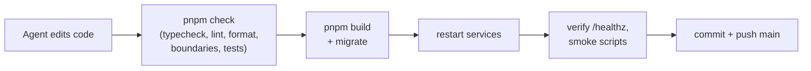

# Operations

## URLs

| What               | URL                                 |
| ------------------ | ----------------------------------- |
| App + Status page  | https://news-digest.exe.xyz/        |
| Health check       | https://news-digest.exe.xyz/healthz |
| Handbook           | https://news-digest.exe.xyz/docs/   |
| DB schema explorer | https://news-digest.exe.xyz/db/     |

## Services (systemd user units on the VM)

| Unit                 | Runs                                                                   |
| -------------------- | ---------------------------------------------------------------------- |
| `news-digest-api`    | API + web UI on :8000; forwards `/docs/` and `/db/`                    |
| `news-digest-worker` | All jobs and timers                                                    |
| `news-digest-docs`   | This handbook (loopback :8100)                                         |
| `news-digest-schema` | DB schema explorer (loopback :8200)                                    |
| `news-digest-agent`  | The build agent's supervisor (see [agent docs](../02-agent/README.md)) |

```bash
systemctl --user status 'news-digest-*'            # are they up?
systemctl --user restart news-digest-api news-digest-worker
journalctl --user -u news-digest-worker -n 100     # recent worker logs
docker compose ps                                  # Postgres + Redis
```

## How to tell if things are healthy

The **Status page** in the app is the dashboard. It shows:

- each source's last success and errors;
- queue state and recent job runs (including whether the last edition used AI
  or the fallback);
- per-topic coverage for the last 24 hours;
- AI and X spend against their caps.

`/healthz` returns 200 only when both Postgres and Redis respond. The agent's
supervisor also checks it after every iteration.

## How code reaches production

There is no separate CI/CD. The build agent works directly on the VM:



## Tests

| Suite                  | Command                 | Uses                                                    |
| ---------------------- | ----------------------- | ------------------------------------------------------- |
| Unit                   | `pnpm test:unit`        | Pure logic, fakes; database access blocked              |
| Integration            | `pnpm test:integration` | Throwaway Postgres + Redis via Testcontainers           |
| Everything             | `pnpm check`            | Both suites plus typecheck, lint, format and boundaries |
| Smoke (live, explicit) | `scripts/smoke-*.ts`    | Real browser/UI checks against the running app          |

Rules: tests never call live external services. AI responses come from fakes
or recorded fixtures. Live checks are opt-in and budgeted.
