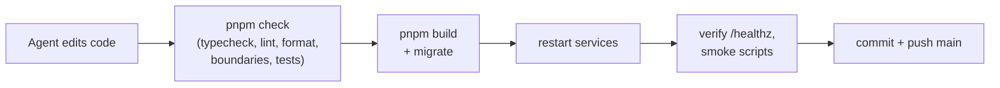

# Operations

## URLs

| What               | URL                                           |
| ------------------ | --------------------------------------------- |
| App + Status page  | https://news-digest.exe.xyz/                  |
| Health check       | https://news-digest.exe.xyz/healthz           |
| Handbook           | https://news-digest.exe.xyz/docs/             |
| DB schema explorer | https://news-digest.exe.xyz/db/               |
| Log browser        | https://news-digest.exe.xyz/logs/select/vmui/ |

## Services (systemd user units on the VM)

| Unit                 | Runs                                                                   |
| -------------------- | ---------------------------------------------------------------------- |
| `news-digest-api`    | API + web UI on :8000; forwards `/docs/`, `/db/` and `/logs/`          |
| `news-digest-worker` | All jobs and timers                                                    |
| `news-digest-docs`   | This handbook (loopback :8100)                                         |
| `news-digest-schema` | DB schema explorer (loopback :8200)                                    |
| `news-digest-agent`  | The build agent's supervisor (see [agent docs](../02-agent/README.md)) |

```bash
systemctl --user status 'news-digest-*'            # are they up?
systemctl --user restart news-digest-api news-digest-worker
journalctl --user -u news-digest-worker -n 100     # recent worker logs
docker compose ps                                  # Postgres + Redis
```

The log store and shipper are separate **system** units (`obs-logs` and
`obs-shipper`), outside the app health gate. Use `systemctl status obs-logs
obs-shipper` and see [Observability](09-observability.md) for limits and recovery.

## Production console

Run `pnpm console` from `~/news-digest` on the VM. It loads
`~/.config/news-digest/env` and opens a Node REPL with a `[PRODUCTION]` prompt.
This is live access: repository methods and SQL can change production data.
Console startup creates a separate Nest application context, without an HTTP
listener, queue workers, schedulers or timers.

Bindings include `app`, `get(Token)`, `db.query(sql, parameters)` and repositories
named `profiles`, `topics`, `content`, `digests`, `social`, `reddit`, `bluesky`.
The repository tokens are also available, for example `get(TopicRepository)`.
Use `await topics.listDefault()` or `await db.query('SELECT current_database()')`.
Explicitly calling digest generation can spend the normal app AI budget.

Exit with `.exit` or Ctrl-D to close database pools. REPL history persists outside
the repository at `~/.local/state/news-digest/console-history`; avoid entering
secrets, since commands are saved there.

## How to tell if things are healthy

The **Status page** in the app is the dashboard. It shows:

- each source's last success and errors;
- queue state and recent job runs (including whether the last edition used AI
  or the fallback);
- per-topic coverage for the last 24 hours;
- AI and X spend against their caps.

`/healthz` returns 200 only when both Postgres and Redis respond. The agent's
supervisor also checks it after every iteration.

The read-only edition timing report (`pnpm exec tsx scripts/report-edition-timing.ts`,
with the configured database environment loaded) joins retained completed jobs,
published editions and their provider charges. It preserves the latest retained
settled scheduled result even after newer manual completions or an upcoming job,
and shows pending or failed
scheduled jobs plus recent failures. Add `--scheduled-only --limit 20` to compare
retained scheduled history (newest intended schedule first). The default limit is
three; completed and failed lists are limited separately, up to twenty each.
The latest settled scheduled completion is preserved even if that adds one run
to a mixed manual/scheduled list. Selection happens before edition/charge reads;
queue retention still limits history. The report includes selection counts. Missing retained evidence does not prove
that a run never happened; failure details remain in logs. It separates final-attempt worker
duration from signed offsets between the intended schedule and start/completion.
Positive offsets mean later; manual runs have no schedule offset. These offsets
include scheduling delay and earlier retries, so they do not measure pure queue
wait or fresh AI latency. A failed edition or charge read preserves the other
runs and the unavailable job’s timing, marks evidence incomplete and exits
nonzero; it does not imply a failed digest. The report never starts a job or calls a provider.

The stored Bluesky coverage report (`pnpm exec tsx scripts/report-bluesky-coverage.ts`)
reads a rolling 24-hour publication window without contacting Bluesky or an LLM.
For each enabled topic it shows stored observations, distinct posts, newest
observation time, safe engaged candidates (up to 50) and phrase matches limited
to the post budget. Three engagement-ranked examples include saved API counts
and links. Reads stop at 5,000 observations per topic and flag that limit.
These are candidate coverage checks, not semantic relevance, editorial picks,
platform-wide activity or measured growth. Use the edition report to confirm
what was actually published.

The timing report also includes per-platform selected-post counts and original links, authors, publication times and saved engagement from each immutable edition. Missing historical selections are unknown; an explicit empty selection has zero counts. Missing metrics or observation times remain unknown. These snapshots do not establish current virality, discovery search attribution or outside-list yield.

## Connect to the database from your laptop

Use your own client (Beekeeper Studio, DBeaver) through its built-in SSH
tunnel. No port is opened on the VM.

| Setting       | Value                                                           |
| ------------- | --------------------------------------------------------------- |
| SSH host      | `news-digest.exe.xyz`, port 22, user `exedev`, your SSH key     |
| DB host, port | `127.0.0.1`, `5432` (as seen from the VM)                       |
| Database      | `news_digest`                                                   |
| Read-only     | user `owner_ro`: can't write or change schema, 60 s query limit |
| Read-write    | user `owner_rw`: can change rows, but can't change schema       |

Passwords live only in the VM's env file. To see them, run this in your own
terminal:
`ssh news-digest.exe.xyz 'grep ^OWNER_DB_ ~/.config/news-digest/env'`.

> [!TIP]
> Make read-only your default connection. Save read-write as a second
> connection, colored red.

## How code reaches production

There is no separate CI/CD. The build agent works directly on the VM:



## Tests

| Suite                  | Command                 | Uses                                                    |
| ---------------------- | ----------------------- | ------------------------------------------------------- |
| Unit                   | `pnpm test:unit`        | Pure logic, fakes; database access blocked              |
| Integration            | `pnpm test:integration` | Throwaway Postgres + Redis via Testcontainers           |
| Everything             | `pnpm check`            | Both suites plus typecheck, lint, format and boundaries |
| Smoke (live, explicit) | `scripts/smoke-*.ts`    | Real browser/UI checks against the running app          |

Rules: tests never call live external services. AI responses come from fakes
or recorded fixtures. Live checks are opt-in and budgeted.

Integration-test database storage uses memory-backed tmpfs mounts. Test runs do
not create anonymous Docker data volumes, including when interrupted; the test
containers never use production data.
