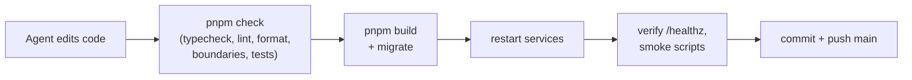

# Operations

## URLs

Reader: `/`, with full, wrapping headlines in desktop contents and the mobile Contents menu, plus mobile topic chips. Contents moves keyboard focus to the chosen heading or story. Brief headlines that match a saved story jump directly to it. Copy a story hash to reopen it directly. Story source names link to their articles, with outlet favicons and the primary publisher first, showing each publisher once even when it has several feeds; All stories show their publication date and local time. Grouped coverage shows the total article count; expand it to read all reports, including the primary article and saved supporting reports cited by the editor, with each report’s publication date, local time and one publisher label instead of repeated feed sections. The article disclosure is available even for a single report, showing its original headline and link. Posts show the same concise publication date and local time as stories, and show useful saved editorial commentary below the original text or embed; self-explanatory posts need no commentary; X author names link to their saved profiles, saved X text links directly to the post, and an opened saved-text panel stays open when switching themes. Contents follows the current story as you scroll; mobile topic chips follow the current topic. X media resizes after rotation or window changes, keeping the saved-text panel’s open state. Its previous height stays reserved while replacement media loads, preventing the media area from collapsing. Keyboard focus stays on saved text or its disclosure while media reloads for a resize or theme change. A loading status appears while the official X post is requested. If it fails, the card offers a retry and points to the original on X, since saved text can be incomplete. Retry moves keyboard focus to the saved post link. Header arrows open the adjacent saved editions; the date opens the archive (month/day on small screens, with the year on wider screens). Past editions at `/editions`, with dates, saved coverage periods, topics and page links. Each opens its saved `/editions/:id` page. Discovery feeds carry a “via” label (Hacker News and Google News), distinguishing them from reporting outlets. Management: `/admin`, with Overview, Editions, Sources, Topics, Schedule, Spend and Tools navigation (mobile menu).
Private status requires an admin. Public mode allows anonymous status GET/HEAD and selects sanitized health, counts, coverage and production budget totals; other methods remain denied. Build the web app with `VITE_PUBLIC_MODE=1` alongside server `PUBLIC_MODE=1` to expose the read-only overview at `/admin` and published editions at `/admin/editions` and `/admin/editions/:id`; private builds retain the admin guard. APIs use `/api/admin/*`; old API paths return 404. Other `/admin` pages, private APIs and every tool below require [admin identity](01-stack-and-runtime.md#admin-identity); public mode separately allows the audited read APIs. `/api/me` reports access. Public-mode edition history includes the latest published reader link; history and detail show published content only.
Local scripts read `ADMIN_LOCAL_TOKEN` from the private env file and send it only
to protected paths at `http://127.0.0.1:8000`, refusing redirects. Browser checks
receive response bodies through Node; credentials never enter Playwright.

| What               | URL                                                                                      |
| ------------------ | ---------------------------------------------------------------------------------------- |
| Reader             | https://news-digest.exe.xyz/                                                             |
| Management         | https://news-digest.exe.xyz/admin                                                        |
| Health check       | https://news-digest.exe.xyz/healthz                                                      |
| Handbook           | https://news-digest.exe.xyz/docs/                                                        |
| DB schema explorer | https://news-digest.exe.xyz/db/                                                          |
| Monitoring         | `/grafana/`, `/logs/`, `/metrics/`, `/queues/`: see [Observability](09-observability.md) |

## Services (systemd user units on the VM)

| Unit                 | Runs                                                                     |
| -------------------- | ------------------------------------------------------------------------ |
| `news-digest-api`    | API + web UI on :8000; forwards the docs, DB explorer and monitoring UIs |
| `news-digest-worker` | All jobs and timers                                                      |
| `news-digest-docs`   | This handbook (loopback :8100)                                           |
| `news-digest-schema` | DB schema explorer (loopback :8200)                                      |
| `news-digest-agent`  | The build agent's supervisor (see [agent docs](../02-agent/README.md))   |

```bash
systemctl --user status 'news-digest-*'            # are they up?
systemctl --user restart news-digest-api news-digest-worker
journalctl --user -u news-digest-worker -n 100     # recent worker logs
docker compose ps                                  # Postgres + Redis
```

Backups: `~/backups/news-digest/` plus encrypted B2 copies; [timers and recovery](10-backups.md). B2 snapshot Nov 7: **8,366,001 / 3,000,000,000 bytes (0.279%)**. Storage estimate: $0.000058/month before the shared free tier; expected $0 within the account’s 10 GB free allowance. B2 alert activation awaits the owner’s root-file deployment.

## How to tell if things are healthy

- **New edition at `/admin/editions/new`:** choose 6 h, 24 h, 7 d or a custom window; uses AI budget, shows topic progress and links to the saved result.
- **Editions at `/admin/editions`:** saved windows, per-topic story/post modes and retained job type, attempts and final-attempt duration; open an edition for recorded AI cost and unresolved holds by model/purpose, inspect topic stories, scores, selection reasons, grouping and source evidence, browse retained articles published in the window (up to 500 per topic, using current source connections), or view it as a reader. `READER_PUBLISHED_ONLY=1` restricts reader latest/history/direct links to published, non-test editions; admin keeps all editions. Currently off pending metadata migration and saved-content comparison ([rollout](../../public-access-plan.md)).
- **Topics at `/admin/topics`:** drag or arrow ordering, enable controls, story/post budgets and New topic dialog. Open a topic for guidance, budgets, phrase filters, X accounts, X minimum likes and exclusions, a dedicated Bluesky query (blank keeps the existing fallback), Reddit communities, connected feeds and news queries, or deletion. Prepared public mode shows the catalog and linked topic details read-only, with disabled controls; private mode requires admin sign-in.
- **Schedule at `/admin/schedule`:** next run, daily local time, timezone, coverage and default topic budgets.
- **Sources at `/admin/sources`:** collection health, connected topics with editor links, timestamps, article counts by publication time over 24 hours/7 days, last-response/stored counts and platform status. The collection switch pauses a feed across all topics while preserving connections and saved articles; enabled feeds need an enabled topic to collect. Add feed connects a public feed to a chosen topic. Use Manage topics & feeds for existing connections or news queries.
- **Spend at `/admin/spend`:** AI/X budget totals, scheduled reserve and the latest 20 calls for each provider, with status, cost, unresolved hold and token counts.
- **Overview at `/admin`:** health, firing and pending monitoring alerts, daily spend, latest edition with recorded AI cost, unresolved holds and inspector link, source issues and next runs.
- **`/healthz`:** 200 when Postgres and Redis respond; `pnpm obs alerts` and [Grafana](09-observability.md) cover the rest.

Read-only checks: `pnpm exec tsx <script>`. Protected API reads use the private local admin token:

| Script                               | Shows                                                                                                                                                                                                                                     |
| ------------------------------------ | ----------------------------------------------------------------------------------------------------------------------------------------------------------------------------------------------------------------------------------------- |
| `scripts/report-edition-timing.ts`   | Recent editions: duration, cost, AI or fallback, saved X engagement evidence and Bluesky slot outcomes. Add `--scheduled-only --limit 20` for scheduled history                                                                           |
| `scripts/report-x-discovery.ts`      | X search spend and yield for a UTC day (`report-x-week.ts` for seven days)                                                                                                                                                                |
| `scripts/smoke-admin-gate.ts`        | Admin denial and local access; `smoke-reader-layout.ts` checks contents, mobile navigation and story links; `smoke-reader-archive.ts` checks archive paging and errors; `smoke-reader-story-text.ts <edition-id>` checks saved story text |
| `scripts/report-bluesky-coverage.ts` | Stored Bluesky posts per topic over the last 24 hours                                                                                                                                                                                     |

## Production console

`pnpm console`, run from `~/news-digest` on the VM, opens a Node REPL with
the app loaded and a `[PRODUCTION]` prompt. It starts no web server, workers
or timers.

- **Available:** `app`, `get(Token)`, `db.query(sql, params)`, and
  repositories (`profiles`, `topics`, `content`, `digests`, `social`,
  `reddit`, `bluesky`). For example: `await topics.listDefault()`.
- **It's live:** repository calls and SQL change production data, and
  calling digest generation spends the AI budget.
- **Exit** with `.exit` or Ctrl-D. History is saved to
  `~/.local/state/news-digest/console-history`, so don't type secrets.

## Connect to the database from your laptop

Use your own client (Beekeeper Studio, DBeaver) through its built-in SSH
tunnel. No port is opened on the VM.

| Setting       | Value                                                           |
| ------------- | --------------------------------------------------------------- |
| SSH host      | `news-digest.exe.xyz`, port 22, user `exedev`, your SSH key     |
| DB host, port | `127.0.0.1`, `5432` (as seen from the VM)                       |
| Database      | `news_digest`                                                   |
| Read-only     | user `owner_ro`: can't write or change schema, 60 s query limit |
| Read-write    | user `owner_rw`: can change rows, but can't change schema       |

Passwords live only in the VM's env file. To see them, run this in your own
terminal:
`ssh news-digest.exe.xyz 'grep ^OWNER_DB_ ~/.config/news-digest/env'`.

> [!TIP]
> Make read-only your default connection. Save read-write as a second
> connection, colored red.

## How code reaches production



## Tests

| Suite                  | Command                 | Uses                                                      |
| ---------------------- | ----------------------- | --------------------------------------------------------- |
| Unit                   | `pnpm test:unit`        | Pure logic, fakes; database access blocked                |
| Integration            | `pnpm test:integration` | Throwaway Postgres + Redis (in memory) via Testcontainers |
| Everything             | `pnpm check`            | Both suites plus typecheck, lint, format and boundaries   |
| Smoke (live, explicit) | `scripts/smoke-*.ts`    | Real browser/UI checks against the running app            |

Tests use fake or recorded AI responses, never live external services.
