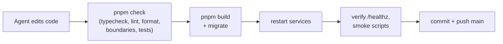

# Operations

## URLs

All of these are behind the exe.dev login. Reserved `/admin` and `/api/admin`
paths require [admin identity](01-stack-and-runtime.md#admin-identity); `/api/me` reports access.
`pnpm obs sources|jobs` reads its local token from the env file for `/api/admin/status`.
Current tools and Status keep the URLs below.

| What               | URL                                                                                      |
| ------------------ | ---------------------------------------------------------------------------------------- |
| App + Status page  | https://news-digest.exe.xyz/                                                             |
| Health check       | https://news-digest.exe.xyz/healthz                                                      |
| Handbook           | https://news-digest.exe.xyz/docs/                                                        |
| DB schema explorer | https://news-digest.exe.xyz/db/                                                          |
| Monitoring         | `/grafana/`, `/logs/`, `/metrics/`, `/queues/`: see [Observability](09-observability.md) |

## Services (systemd user units on the VM)

| Unit                 | Runs                                                                     |
| -------------------- | ------------------------------------------------------------------------ |
| `news-digest-api`    | API + web UI on :8000; forwards the docs, DB explorer and monitoring UIs |
| `news-digest-worker` | All jobs and timers                                                      |
| `news-digest-docs`   | This handbook (loopback :8100)                                           |
| `news-digest-schema` | DB schema explorer (loopback :8200)                                      |
| `news-digest-agent`  | The build agent's supervisor (see [agent docs](../02-agent/README.md))   |

```bash
systemctl --user status 'news-digest-*'            # are they up?
systemctl --user restart news-digest-api news-digest-worker
journalctl --user -u news-digest-worker -n 100     # recent worker logs
docker compose ps                                  # Postgres + Redis
```

Backups: `~/backups/news-digest/`; [nightly timers and restore](10-backups.md).

## How to tell if things are healthy

- **The Status page** in the app shows:
  - each source's last success and errors;
  - queue state and recent runs, including whether the last edition used
    AI or the fallback;
  - per-topic coverage for the last 24 hours;
  - AI and X spend against their caps.
- **`/healthz`** returns 200 only when both Postgres and Redis respond. The
  agent's supervisor checks it after every iteration.
- **`pnpm obs alerts`** and Grafana cover the rest: see
  [Observability](09-observability.md).

Read-only reports (run with `pnpm exec tsx <script>`). Timing and Bluesky
coverage, the Bluesky probe and monitoring checks use the private local admin token for protected API reads:

| Script                               | Shows                                                                                                                        |
| ------------------------------------ | ---------------------------------------------------------------------------------------------------------------------------- |
| `scripts/report-edition-timing.ts`   | Recent editions: duration, cost, AI or fallback, picks per platform. Add `--scheduled-only --limit 20` for scheduled history |
| `scripts/report-x-discovery.ts`      | X search spend and yield for a UTC day (`report-x-week.ts` for seven days)                                                   |
| `scripts/report-bluesky-coverage.ts` | Stored Bluesky posts per topic over the last 24 hours                                                                        |

## Production console

`pnpm console`, run from `~/news-digest` on the VM, opens a Node REPL with
the app loaded and a `[PRODUCTION]` prompt. It starts no web server, workers
or timers.

- **Available:** `app`, `get(Token)`, `db.query(sql, params)`, and
  repositories (`profiles`, `topics`, `content`, `digests`, `social`,
  `reddit`, `bluesky`). For example: `await topics.listDefault()`.
- **It's live:** repository calls and SQL change production data, and
  calling digest generation spends the AI budget.
- **Exit** with `.exit` or Ctrl-D. History is saved to
  `~/.local/state/news-digest/console-history`, so don't type secrets.

## Connect to the database from your laptop

Use your own client (Beekeeper Studio, DBeaver) through its built-in SSH
tunnel. No port is opened on the VM.

| Setting       | Value                                                           |
| ------------- | --------------------------------------------------------------- |
| SSH host      | `news-digest.exe.xyz`, port 22, user `exedev`, your SSH key     |
| DB host, port | `127.0.0.1`, `5432` (as seen from the VM)                       |
| Database      | `news_digest`                                                   |
| Read-only     | user `owner_ro`: can't write or change schema, 60 s query limit |
| Read-write    | user `owner_rw`: can change rows, but can't change schema       |

Passwords live only in the VM's env file. To see them, run this in your own
terminal:
`ssh news-digest.exe.xyz 'grep ^OWNER_DB_ ~/.config/news-digest/env'`.

> [!TIP]
> Make read-only your default connection. Save read-write as a second
> connection, colored red.

## How code reaches production



## Tests

| Suite                  | Command                 | Uses                                                      |
| ---------------------- | ----------------------- | --------------------------------------------------------- |
| Unit                   | `pnpm test:unit`        | Pure logic, fakes; database access blocked                |
| Integration            | `pnpm test:integration` | Throwaway Postgres + Redis (in memory) via Testcontainers |
| Everything             | `pnpm check`            | Both suites plus typecheck, lint, format and boundaries   |
| Smoke (live, explicit) | `scripts/smoke-*.ts`    | Real browser/UI checks against the running app            |

Tests use fake or recorded AI responses, never live external services.
