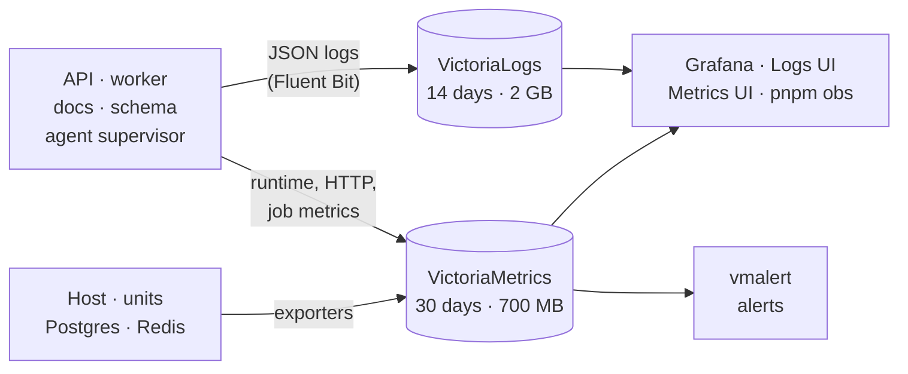

# Observability

A small, free monitoring stack runs on the VM. It is private: the UIs sit
behind the exe.dev login, and every store listens only on `127.0.0.1`. The prepared public SQL reader exposes published daily edition/content counts and bounded source health. A separate prepared overview uses those projections for three aggregate tables and export age (red after 15 minutes; missing or future capture shows “No valid export”). The prepared exporter transfers counts between separate local database ports using a read-only source session and a restricted writer. Its prepared database service binds port 5543 to loopback on a separate dedicated Docker bridge network and requires a password. A prepared freshness alert checks every minute and alerts on unreadable exports or five minutes of missing, future-dated or stale captures. Exporter, alert, database service and overview remain uninstalled; public mode omits Grafana from the tool proxy. Prepared public mode allows fresh admins to read metrics instant/range queries and log queries, hit counts, statistics, field metadata and time bounds via GET or bounded form POST (16 KiB, five-second upload limit); Reviewed native build, tenant, configuration, timezone and dashboard metadata is GET-only for fresh admins. The exact reviewed native UI documents, scripts and styles are GET-only for fresh admins, with a same-origin content security policy. Metrics exports are limited at the store to 32 series and two seconds. Prepared public export admission remains closed. Mutation routes stay closed.



## Where to look

| Question                              | Look at                                                     |
| ------------------------------------- | ----------------------------------------------------------- |
| Is anything wrong right now?          | `pnpm obs alerts`, then Grafana → Errors and logs           |
| How did today's edition go?           | Grafana → Product (cost, modes, picks) and Jobs             |
| Why did something fail?               | [Logs UI](/logs/select/vmui/): `service:worker level:error` |
| Is the VM short of CPU, memory, disk? | Grafana → Host and Services                                 |
| What are the queues doing?            | [Jobs browser](/queues/) (read-only)                        |
| Is the database slow?                 | Grafana → Database (top statements, slow calls)             |
| Is the agent healthy?                 | Grafana → Agent supervisor                                  |

## UIs

| UI                         | Shows                                                                                                                    |
| -------------------------- | ------------------------------------------------------------------------------------------------------------------------ |
| [Grafana](/grafana/)       | 10 dashboards: Host, Services, App runtime, HTTP, Jobs, Errors and logs, Product, Database, Redis, Agent supervisor      |
| [Logs](/logs/select/vmui/) | Every structured log line, searchable with LogsQL                                                                        |
| [Metrics](/metrics/vmui/)  | Raw metric queries (PromQL)                                                                                              |
| Jobs                       | Fresh-admin only: [read-only jobs browser](/queues/). Public mode: `GET /api/queues` for counts and next scheduled runs. |

Dashboards live in `ops/observability/grafana/`; empty panels mean "nothing observed".

Metrics deletion and forced merges require separate keys in `~/.config/news-digest/env`; the installer requires both. Normal queries and scraping need no key.

- **Log search limits:** two concurrent requests, 5s execution, 1s queueing, 24h time window and 4 KiB query text, for admin browser and direct queries.

## What is collected

| Kind         | What                                                                                                                                                                                                                                                                                                                                             |
| ------------ | ------------------------------------------------------------------------------------------------------------------------------------------------------------------------------------------------------------------------------------------------------------------------------------------------------------------------------------------------ |
| Logs         | HTTP requests, job runs, every external call (feeds, HN, X, Anthropic, xAI, Bluesky), AI and X budget decisions (including AI cap, model-share, reserve and provider-block reasons), AI rejection categories (including fixed schema issue codes) with step and topic IDs, edition stages, errors with stacks, browser errors, DB calls ≥ 250 ms |
| Metrics      | Host and per-unit resources, Node runtime, HTTP rate and latency per route, external calls per target, job durations, queue states, Postgres and Redis stats, top statements, spend against caps, agent heartbeat                                                                                                                                |
| Product data | Grafana reads Postgres directly through a read-only login: editions, spend, sources, social picks                                                                                                                                                                                                                                                |

- **Correlated:** each request returns an `X-Request-Id`, and job, run and
  edition IDs are carried on every related line. For example,
  `pnpm obs logs --edition <id>` shows one edition's whole run.
- **X execution:** paid responses log `execution` separately from transport `outcome`; unconfirmed searches warn, confirmed empty searches stay informational.
- **Private by design:** logs and metrics never hold secrets, prompts, AI
  responses, article text, URLs or SQL. Redaction is tested.

## Alerts

vmalert evaluates every 30 s. A separate user timer polls it every minute,
including when the API or worker is down. `pnpm obs alerts` includes the last
five file events alongside current alerts. Nothing is emailed.

- **File:** `~/.local/state/news-digest/alerts/alerts.jsonl`; JSON events contain
  time, firing/resolved state, name, severity, summary and a delivery ID.
  Rotation keeps the current file and one old copy, each at most 5 MB.
- **Changes only:** pending alerts are ignored; disk state prevents repeats
  after restart. Evaluator outages and recovery also produce events.
- **Destinations:** implement `AlertDestination.send`, then import the adapter
  and add it to the list in `scripts/dispatch-alerts.ts` (two wiring lines).
  Failed deliveries retry on the next run without blocking other destinations.
- **Timer:** `news-digest-alert-dispatch.timer`; install with
  `sh ops/alerting/install.sh` outside 13:00–16:00 UTC. An independent user timer
  feeds its active state, latest result and three-minute freshness into the
  existing ServiceDown rule. No root-owned monitoring configuration changes.

| Alert             | Fires when                                                                                                       |
| ----------------- | ---------------------------------------------------------------------------------------------------------------- |
| Disk              | Any filesystem is over 80% for 2 min                                                                             |
| Memory            | Host has under 10% free for 5 min, or an `obs-*` service is over 90% of its limit                                |
| Service down      | A monitored unit is inactive, or a scrape fails, for 2 min                                                       |
| Agent crash loop  | The build agent's supervisor records 3 failed iterations in a row (usage-limit waits excluded) for 1 min         |
| Errors            | API 5xx over 5% (with at least 20 requests in 5 min), or new worker job failures                                 |
| Scheduled edition | The digest scheduler is missing, paused or stalled, or a due run isn't recorded or settled 15 min after its time |
| Bluesky editing   | Latest scheduled edition has failed, budget-refused or missing Bluesky results while enabled                     |
| Bluesky quiet     | Three scheduled editions with an open Bluesky slot have no pick; clears on a pick                                |
| Spend             | Anthropic or xAI reaches 90% of a daily or monthly cap                                                           |

## Command line

```sh
pnpm obs alerts                                  # pending and firing alerts
pnpm obs health                                  # also: services, sources, targets; add --check for an exit code
pnpm obs errors --since 1h
pnpm obs logs --service worker --since 1h        # also: --edition, --queue/--job, --grep
pnpm obs jobs --check                            # all queues; --queue digest-generation checks just that queue
pnpm obs jobs --queue digest-generation --state failed
pnpm obs metric 'up' --since 1h --step 60s
```

## Resources and operations

- **Metrics credentials:** private `metrics.env` contains only the two mutation keys. After rotating them in the app secrets file, run `python3 ops/observability/metrics-credentials.py` and restart `obs-metrics.service`.
- **Resources:** `obs-*` system units have memory and CPU caps. Grafana uses
  512 MB, logs 160 MB, metrics 112 MB, others 80 MB or less. Metrics has a
  2% CPU cap. Target: about 800 MiB and under 5% CPU; measured stack: 754 MiB.
- **Grafana startup:** start/stop hooks allow 512/544 MB and 50% CPU;
  readiness restores 448/512 MB and 3%. Cold executable cache needs this headroom.
- **Install or reconcile:** `ops/observability/install*.sh`; releases are pinned
  and checksum-checked. App, Postgres and Redis are not restarted, except the
  first query-statistics install, which waits for a safe window.
- **Check:** `systemctl status 'obs-*'`, and
  `pnpm exec tsx scripts/check-observability.ts` for a full read-only check.
  Flags like `--verify-grafana` and `--verify-alerts` check one area.
- **API down:** tunnel with `ssh -L 3001:localhost:3001 news-digest.exe.xyz`
  and open `localhost:3001/grafana/`; logs/metrics use ports 9428/8428.

Background: [capacity decision](../../decisions/0004-observability-capacity.md).
