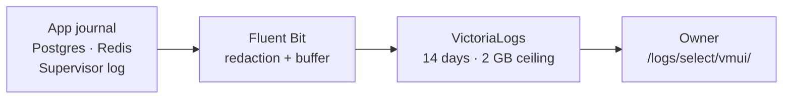

# Observability

The API and worker write structured JSON to the systemd journal. Each line
has a service name, numeric severity and timestamp. Fluent Bit ships their
logs, the docs/schema journals, the two production container logs and the
supervisor log into a local VictoriaLogs store. Codex transcripts are excluded.
The [log browser](/logs/select/vmui/) shares the app’s private exe.dev login.
It supports LogsQL queries such as `service:worker event:job.failure`.
Structured fields remain searchable; stored severity uses names such as `info`.

The store listens only on `127.0.0.1:9428` and keeps up to 14 days, deleting
older daily partitions around 1.8 GB. A dedicated 2 GB filesystem imposes a
hard ceiling even within one day. If full, shipping can fail; the journal
remains available independently. Journald has a 500 MB configured limit.
Fluent Bit has a 32 MB retry buffer and persistent cursors; exhausted buffering
can drop older pending logs. Shipping is best effort and may repeat records
after a crash. Existing journal/container timestamps are retained; plain
supervisor lines use collection time, including the initial backfill.

`obs-logs` and `obs-shipper` are system units outside the app health gate.
Their memory limits are 160/80 MiB, CPU quotas 3%/1% of one core, nice level
10 and low CPU/IO weights. The mount helper `obs-log-volume` creates no
background process. Host metrics and Grafana dashboards are described below.

Install or reconcile with `ops/observability/install.sh`: pinned official
releases are SHA-256 checked. Re-run after recreating production containers
so only their new log paths are selected. The installer never restarts them.
Read status with `systemctl status obs-logs obs-shipper`; query locally at
`http://127.0.0.1:9428/logs/select/logsql/query`. If the app is down, an SSH
forward to localhost port 9428 provides access at `/logs/select/vmui/`.
Stopping the log units preserves their data and the mounted volume.

| Activity              | What the journal records                                                                                                                |
| --------------------- | --------------------------------------------------------------------------------------------------------------------------------------- |
| HTTP requests         | Generated request ID, method, route template, status, elapsed milliseconds and completion or disconnect                                 |
| Queue jobs            | Queue and job IDs, attempt number, start, finish or failure, elapsed milliseconds                                                       |
| Feed/HN/X embed calls | Target category, HTTP status when received, success/redirect/failure and elapsed milliseconds; cached reads produce no call entry       |
| Anthropic calls       | Model, purpose, run ID, attempt, duration, success or failure, failure HTTP status and successful token usage/computed microdollar cost |
| xAI calls             | Model, search type, HTTP status, duration, outcome, safe failure reason and successful token/fetched-item/citation counts               |
| Bluesky calls         | Login, refresh or search, HTTP status when received, duration and outcome; no account, token, query, URL or response content            |
| X discovery budgets   | Admission/refusal and estimate by run/topic/search type; settled cost, released/uncertain holds and provider credit block               |
| Anthropic budgets     | Admission/refusal and estimate per attempt; settled cost or released/uncertain failure hold, with run and inherited job context         |
| Errors                | Error message, stack and cause; fatal exceptions and unhandled rejections exit unsuccessfully so systemd can recover the service        |

The API returns `X-Request-Id` so a browser request can be matched to its
journal entry. Request context and job context remain separate when work
runs concurrently. Static files and unmatched requests use a generic route
label; request URLs, queries, bodies and headers are omitted.

Official X oEmbed requests use the `x-oembed` target category; feed and Hacker
News requests keep their own categories. A successful HTTP response does not
mean the embed passed the subsequent content validation.

External HTTP logs inherit the current job or request context. URLs, bodies and
provider error messages are omitted. Each redirect hop is recorded separately;
rate-limit waiting and cached reads do not count as network time. Anthropic retries
produce separate entries; failed calls have no inferred usage or cost. The ledger
remains the authority for settled spend. Prompts and generated text are omitted.

Credential fields and configured secret values are redacted before log
serialization, including error stacks. API and worker logs can be read with
`journalctl --user -u news-digest-api -u news-digest-worker -n 40 --no-pager`.
The journal also contains older plain-text entries from earlier versions.

> [!NOTE]
> Structured API/worker logging and local log collection are installed.
> Additional dashboards and browser error reporting remain planned.
> See the [approved observability plan](../../observability-plan.md).

xAI outcomes include response parsing and usage validation. Failed attempts have no
inferred usage; configured prices and settled costs stay in the discovery ledger.
Search topics, account lists, guidance, citations and provider text are omitted.

Bluesky outcomes cover HTTP and JSON reading; session and post validation follow
a successful attempt. Session reuse adds no login entry. Refreshes and pagination
produce separate attempts, with rate-limit waiting excluded from duration.

Budget entries follow successful ledger operations. Refusals do not identify the
limiting cap; the ledger remains authoritative. Cache reuse adds no admission.
Repairs reserve separately, and transport failures retain uncertain holds. No
prompt, response, purpose or provider error text is included in budget entries.

X discovery budget entries omit topic names, guidance, handles and provider text.
A refusal may also mean durable scheduled admission was already consumed; no
cap or refusal cause is inferred. Settlement logs precede citation persistence,
so a storage failure does not hide a charge. Credit exhaustion releases that
call’s hold while blocking further discovery in the ledger.

Anthropic reserve admission logs include the UTC budget day, lifecycle state,
scheduled eligibility, protected reserve, other-spend limit and effective
available funds. They distinguish a reserve shortfall from the final admission
result: another cap or provider block may also refuse the call. These entries
follow the ledger transaction commit and omit request content and purpose.
Verification calls rejected by their separate early cap do not reach this log.

Reserve lifecycle entries follow committed registration, reconciliation, claim
and completion transactions. They record the operation, budget day or run ID,
attempt and requested state. `applied` means a fenced transition changed a row;
`unchanged` means no eligible row matched. Registration reports `observed` and
the stored state because the first registration wins. Reads are silent, and
edition content and outcome explanations are omitted.

Edition attempts log their run ID, overall stages and per-topic stage transitions
using topic IDs. Repeated progress snapshots do not repeat unchanged stages.
A finish identifies the returned edition and distinguishes publication from reuse;
its duration includes database locking and cleanup, but excludes queue wait.
Failures identify the last observed overall stage without exception text or
content. A publishing-stage entry means publication is starting, not that its
transaction committed. Existing job progress reporting still runs normally.

The read-only runtime check is `pnpm exec tsx scripts/check-observability.ts`.
It matches a health request to the journal, checks completed worker jobs and
validates the fields in sampled structured records. Add `--verify-o1` to also
run offline coverage for all provider categories, budgets and edition stages,
including secret redaction and forced fatal errors in disposable child processes.
It never enqueues a job, publishes an edition or calls a paid provider. An empty
provider or edition count means no event was observed in the journal sample;
it does not claim that path ran live. Migration command output remains plain text.

Run `pnpm exec tsx scripts/check-observability.ts --verify-o2` to check the
seven collected sources, retention, hard filesystem ceiling, unit limits,
private UI forwarding and a fresh API request reaching the store within 60 s.
An isolated dummy-input Fluent Bit child checks redaction without reading live
logs or calling providers. Existing records from quieter services prove their
collection, not recent activity. File shipping also redacts configured credential
values, nested credential fields, bearer tokens and URL passwords.

## Jobs browser

Open [/queues/](/queues/) for the four live BullMQ queues, counts by state,
retained job progress, results and failures. **Schedulers** lists all recurring
jobs, their interval, next run and last retained run. On mobile, open the
**Overview** dropdown to select Schedulers or a queue. Times use the browser's
local timezone. A next-run time is a plan, not evidence that a job succeeded.

The browser runs inside the API and shares its existing queue connections;
it adds no service or background collector. The private exe.dev login protects
access. It is read-only: retry, pause, remove and scheduling controls are hidden,
and the API rejects all methods except GET and HEAD under `/queues/`.
Retained failures may describe sources that have since recovered; compare
with the app's Status panel for current source health.

`pnpm exec tsx scripts/check-observability.ts --verify-o3` checks all four
queues, their schedules and the write barrier without creating jobs.
`pnpm exec tsx scripts/smoke-queues.ts` checks desktop/mobile navigation and
saves screenshots using real retained jobs and schedules.

## Host and service metrics

Open [/metrics/vmui/](/metrics/vmui/) to query real host and unit samples.
VictoriaMetrics listens on loopback port 8428, scrapes every 30 seconds and
keeps 30 days. A separate 700 MB filesystem bounds disk use; ingestion stops
with 50 MB free rather than filling the host. Capacity can shorten usable
history. Existing data survives reconciliation. Port 9100 serves node_exporter;
only the metrics store UI is forwarded through the private app login.

| Samples        | Coverage                                                                                                             |
| -------------- | -------------------------------------------------------------------------------------------------------------------- |
| Host           | CPU, available memory, filesystem space, disk/network traffic, load and pressure                                     |
| System units   | `obs-*` state/tasks/restarts from node_exporter                                                                      |
| Unit resources | Four app units, the agent unit and five observability daemons: active state, memory, CPU seconds, tasks and restarts |

A 30-second timer reads explicit user/system units and atomically publishes a
textfile. Its timestamp (`news_digest_unit_snapshot_timestamp_seconds`) makes
stale snapshots visible. CPU counters reset when a unit restarts; use `rate()`.
`news_digest_unit_memory_bytes` shows memory for each unit; `up` shows scrape
health. No agent-control files are read or modified by this collector.

Reconcile with `ops/observability/install-metrics.sh`. Official VictoriaMetrics
1.155.0 and node_exporter 1.12.1 releases are SHA-256 pinned. The store/exporter
have 112/40 MiB memory ceilings and 1%/0.5% CPU ceilings; the brief snapshot
helper has 32 MiB/2%, a 20-second timeout and a 30-second cadence. All lose
CPU/IO contention to the app. The store limits query concurrency and memory.
No app, DB, Redis or log unit is restarted by this installer.

`pnpm exec tsx scripts/check-observability.ts --verify-o4` checks targets,
host/unit samples, freshness, retention, disk and resource limits.
`pnpm exec tsx scripts/smoke-metrics.ts` checks desktop/mobile rendering with
real unit samples. For API outages, forward localhost 8428 over SSH and open
`/metrics/vmui/`. Dashboards remain separate work.

## Node runtime metrics

The API, worker, docs and schema services expose Prometheus runtime samples
on loopback ports 9464, 9465, 9466 and 9467 respectively at `/metrics`. VictoriaMetrics scrapes them every 30 seconds:
process CPU/RAM, heap, garbage collection, event-loop lag and active handles.
The only added label is a fixed service name; content and request identifiers
are excluded. These listeners are separate from the public API and are not
forwarded by it. A listener failure is logged without stopping the app.
The API also records HTTP duration histograms, whose counts give request volume,
by method, route template, status and completion/disconnect. Requests without
a route template share one static/unmatched label; URLs, queries and IDs are omitted. The separate
metrics listener is excluded. Query `news_digest_http_request_duration_seconds_count`
for volume or its histogram buckets for latency. Samples reset on API restart.

External HTTP attempts expose `news_digest_external_call_duration_seconds`
in API and worker, with fixed feed, Hacker News, official X embed, Anthropic,
xAI and Bluesky targets, HTTP status (or unknown), and success/redirect/failure.
Counts exclude cache hits and rate-limit waiting; shared HTTP redirects count
per network hop. Shared HTTP duration includes body reading and decoding;
provider fetch duration ends at response headers, excluding body parsing and
semantic validation. HTTP success does not imply valid provider content.
Anthropic rejection retries and Bluesky login/refresh/search requests count
separately. This metric does not represent token usage or spending; use the ledger
for costs. No URLs, hosts, credentials or post IDs enter labels. Samples reset on
restart; interrupted attempts are absent. Queue snapshots are described below.

The worker records `news_digest_job_duration_seconds` for every settled processor
attempt in the four queues. Counts distinguish completed and failed attempts;
retries count separately. Queue and job names use fixed allowlists, with unknown
values grouped as `other`. IDs, payloads and errors never enter labels. Histograms
reset on worker restart and do not represent retained queue totals or jobs killed
before settling. The API reads retained job counts by state, recurring schedule counts and pause
state through its existing queue connections on each scrape. These gauges use
only four fixed queue names and six states. Completed/failed counts reflect
retention limits, not lifetime totals; delayed includes future scheduled jobs.
Each gauge is a separate snapshot, so a busy queue can change between reads.
A Redis read error fails the scrape with HTTP 503 rather than serving stale
queue values; the next successful scrape recovers. Schedule definitions and job
details remain in the jobs browser.

## Grafana dashboards

Open [/grafana/](/grafana/) and choose **Dashboards → News Digest** for Host,
Services, HTTP, Jobs, Errors and logs, and Product. The operational dashboards use the local metrics store; Host shows CPU,
memory, disk and network, Services shows unit and Node health, HTTP shows
request and external-attempt rates and latency, and Jobs shows retained queue
state, schedules and processor attempts. Dashboard descriptions explain what
the measurements count. Empty panels mean no observed samples, rather than
zero failures. Retained job counts are snapshots, not lifetime totals.
Errors and logs brings together API 5xx, external HTTP failures, failed processor
attempts, retained failed jobs and unit restarts/state. Its Logs link opens the
retained structured events; it does not collect browser errors.

Product reads retained Postgres data every five minutes: settled UTC day/month
spend and all outstanding holds, latest edition story/post modes, source freshness,
rolling 24-hour distinct articles and X citation verification, and seven reserve
lifecycle rows. These table windows are explicit and ignore the Grafana time picker.
AI mode can use cached work; verified citations are not incremental discovery yield.
Configured caps, reserve amounts, available funds and worker duration remain in the
app's **Source & run status** panel; Product does not infer them from ledger rows.

Grafana is a loopback-only service on port 3001, forwarded through the private
app. Anonymous access is Viewer access behind the exe.dev login; login and
signup are disabled, and no initial administrator is created. Dashboards and
the local metrics and read-only product datasources are provisioned from the repository and
cannot be edited in the UI. Live websocket connections, analytics, updates,
plugin installation/key retrieval and Grafana alerting are disabled. Grafana's local
SQLite file stores its own settings. Product uses a dedicated `grafana_product`
Postgres login with named-column SELECT grants, no write grants or role memberships,
two Grafana connections (three role connections including verification) and a
five-second query timeout. It uses the existing loopback-only
Compose trust authentication; no application credentials are supplied.

`ops/observability/install-grafana.sh` reconciles the SHA-256-pinned Grafana
12.4.14 release and provisioning. The `obs-grafana` system unit has a 256 MiB
memory ceiling and 2% CPU quota, with low scheduling priority. Its first
startup migrates its own SQLite database and can take several minutes at that
quota. It never migrates or restarts the app database. Reconcile existing
configuration by copying the repository provisioning or rerunning the installer.

Verify with `pnpm exec tsx scripts/check-observability.ts --verify-grafana
--verify-o4` (one command). It checks health, Viewer access, provisioning, all
panel query responses and populated dashboards, renders desktop/mobile views
with Playwright and saves screenshots in `docs/screenshots/`. No paid calls
or content jobs are triggered. Reader privileges and denied access to cache/article
text are also checked. Database, Redis and agent
dashboards remain pending their data connections and later observability work.
