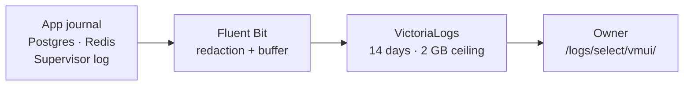

# Observability

The API and worker write structured JSON to the systemd journal. Each line
has a service name, numeric severity and timestamp. Fluent Bit ships their
logs, the docs/schema journals, the two production container logs and the
supervisor log into a local VictoriaLogs store. Codex transcripts are excluded.
The [log browser](/logs/select/vmui/) shares the app’s private exe.dev login.
It supports LogsQL queries such as `service:worker event:job.failure`.
Structured fields remain searchable; stored severity uses names such as `info`.

The store listens only on `127.0.0.1:9428` and keeps up to 14 days, deleting
older daily partitions around 1.8 GB. A dedicated 2 GB filesystem imposes a
hard ceiling even within one day. If full, shipping can fail; the journal
remains available independently. Journald has a 500 MB configured limit.
Fluent Bit has a 32 MB retry buffer and persistent cursors; exhausted buffering
can drop older pending logs. Shipping is best effort and may repeat records
after a crash. Existing journal/container timestamps are retained; plain
supervisor lines use collection time, including the initial backfill.

`obs-logs` and `obs-shipper` are system units outside the app health gate.
Their memory limits are 160/80 MiB, CPU quotas 3%/1% of one core, nice level
10 and low CPU/IO weights. The mount helper `obs-log-volume` creates no
background process. Host metrics and Grafana dashboards are described below.

Install or reconcile with `ops/observability/install.sh`: pinned official
releases are SHA-256 checked. Re-run after recreating production containers
so only their new log paths are selected. The installer never restarts them.
Read status with `systemctl status obs-logs obs-shipper`; query locally at
`http://127.0.0.1:9428/logs/select/logsql/query`. If the app is down, an SSH
forward to localhost port 9428 provides access at `/logs/select/vmui/`.
Stopping the log units preserves their data and the mounted volume.

| Activity              | What the journal records                                                                                                                |
| --------------------- | --------------------------------------------------------------------------------------------------------------------------------------- |
| HTTP requests         | Generated request ID, method, route template, status, elapsed milliseconds and completion or disconnect                                 |
| Queue jobs            | Queue and job IDs, attempt number, start, finish or failure, elapsed milliseconds                                                       |
| Feed/HN/X embed calls | Target category, HTTP status when received, success/redirect/failure and elapsed milliseconds; cached reads produce no call entry       |
| Anthropic calls       | Model, purpose, run ID, attempt, duration, success or failure, failure HTTP status and successful token usage/computed microdollar cost |
| xAI calls             | Model, search type, HTTP status, duration, outcome, safe failure reason and successful token/fetched-item/citation counts               |
| Bluesky calls         | Login, refresh or search, HTTP status when received, duration and outcome; no account, token, query, URL or response content            |
| X discovery budgets   | Admission/refusal and estimate by run/topic/search type; settled cost, released/uncertain holds and provider credit block               |
| Anthropic budgets     | Admission/refusal and estimate per attempt; settled cost or released/uncertain failure hold, with run and inherited job context         |
| Errors                | Error message, stack and cause; fatal exceptions and unhandled rejections exit unsuccessfully so systemd can recover the service        |

The API returns `X-Request-Id` so a browser request can be matched to its
journal entry. Request context and job context remain separate when work
runs concurrently. Static files and unmatched requests use a generic route
label; request URLs, queries, bodies and headers are omitted.

Official X oEmbed requests use the `x-oembed` target category; feed and Hacker
News requests keep their own categories. A successful HTTP response does not
mean the embed passed the subsequent content validation.

External HTTP logs inherit the current job or request context. URLs, bodies and
provider error messages are omitted. Each redirect hop is recorded separately;
rate-limit waiting and cached reads do not count as network time. Anthropic retries
produce separate entries; failed calls have no inferred usage or cost. The ledger
remains the authority for settled spend. Prompts and generated text are omitted.

Credential fields and configured secret values are redacted before log
serialization, including error stacks. API and worker logs can be read with
`journalctl --user -u news-digest-api -u news-digest-worker -n 40 --no-pager`.
The journal also contains older plain-text entries from earlier versions.

> [!NOTE]
> Structured API/worker logging and local log collection are installed.
> Additional dashboards and browser error reporting remain planned.
> See the [approved observability plan](../../observability-plan.md).

xAI outcomes include response parsing and usage validation. Failed attempts have no
inferred usage; configured prices and settled costs stay in the discovery ledger.
Search topics, account lists, guidance, citations and provider text are omitted.

Bluesky outcomes cover HTTP and JSON reading; session and post validation follow
a successful attempt. Session reuse adds no login entry. Refreshes and pagination
produce separate attempts, with rate-limit waiting excluded from duration.

Budget entries follow successful ledger operations. Refusals do not identify the
limiting cap; the ledger remains authoritative. Cache reuse adds no admission.
Repairs reserve separately, and transport failures retain uncertain holds. No
prompt, response, purpose or provider error text is included in budget entries.

X discovery budget entries omit topic names, guidance, handles and provider text.
A refusal may also mean durable scheduled admission was already consumed; no
cap or refusal cause is inferred. Settlement logs precede citation persistence,
so a storage failure does not hide a charge. Credit exhaustion releases that
call’s hold while blocking further discovery in the ledger.

Anthropic reserve admission logs include the UTC budget day, lifecycle state,
scheduled eligibility, protected reserve, other-spend limit and effective
available funds. They distinguish a reserve shortfall from the final admission
result: another cap or provider block may also refuse the call. These entries
follow the ledger transaction commit and omit request content and purpose.
Verification calls rejected by their separate early cap do not reach this log.

Reserve lifecycle entries follow committed registration, reconciliation, claim
and completion transactions. They record the operation, budget day or run ID,
attempt and requested state. `applied` means a fenced transition changed a row;
`unchanged` means no eligible row matched. Registration reports `observed` and
the stored state because the first registration wins. Reads are silent, and
edition content and outcome explanations are omitted.

Edition attempts log their run ID, overall stages and per-topic stage transitions
using topic IDs. Repeated progress snapshots do not repeat unchanged stages.
A finish identifies the returned edition and distinguishes publication from reuse;
its duration includes database locking and cleanup, but excludes queue wait.
Failures identify the last observed overall stage without exception text or
content. A publishing-stage entry means publication is starting, not that its
transaction committed. Existing job progress reporting still runs normally.

The read-only runtime check is `pnpm exec tsx scripts/check-observability.ts`.
It matches a health request to the journal, checks completed worker jobs and
validates the fields in sampled structured records. Add `--verify-o1` to also
run offline coverage for all provider categories, budgets and edition stages,
including secret redaction and forced fatal errors in disposable child processes.
It never enqueues a job, publishes an edition or calls a paid provider. An empty
provider or edition count means no event was observed in the journal sample;
it does not claim that path ran live. Migration command output remains plain text.

Run `pnpm exec tsx scripts/check-observability.ts --verify-o2` to check the
seven collected sources, retention, hard filesystem ceiling, unit limits,
private UI forwarding and a fresh API request reaching the store within 60 s.
An isolated dummy-input Fluent Bit child checks redaction without reading live
logs or calling providers. Existing records from quieter services prove their
collection, not recent activity. File shipping also redacts configured credential
values, nested credential fields, bearer tokens and URL passwords.

## Jobs browser

Open [/queues/](/queues/) for the four live BullMQ queues, counts by state,
retained job progress, results and failures. **Schedulers** lists all recurring
jobs, their interval, next run and last retained run. On mobile, open the
**Overview** dropdown to select Schedulers or a queue. Times use the browser's
local timezone. A next-run time is a plan, not evidence that a job succeeded.

The browser runs inside the API and shares its existing queue connections;
it adds no service or background collector. The private exe.dev login protects
access. It is read-only: retry, pause, remove and scheduling controls are hidden,
and the API rejects all methods except GET and HEAD under `/queues/`.
Retained failures may describe sources that have since recovered; compare
with the app's Status panel for current source health.

`pnpm exec tsx scripts/check-observability.ts --verify-o3` checks all four
queues, their schedules and the write barrier without creating jobs.
`pnpm exec tsx scripts/smoke-queues.ts` checks desktop/mobile navigation and
saves screenshots using real retained jobs and schedules.

## Host and service metrics

Open [/metrics/vmui/](/metrics/vmui/) to query real host and unit samples.
VictoriaMetrics listens on loopback port 8428, scrapes every 30 seconds and
keeps 30 days. A separate 700 MB filesystem bounds disk use; ingestion stops
with 50 MB free rather than filling the host. Capacity can shorten usable
history. Existing data survives reconciliation. Port 9100 serves node_exporter;
only the metrics store UI is forwarded through the private app login.

| Samples        | Coverage                                                                                                             |
| -------------- | -------------------------------------------------------------------------------------------------------------------- |
| Host           | CPU, available memory, filesystem space, disk/network traffic, load and pressure                                     |
| System units   | `obs-*` state/tasks/restarts from node_exporter                                                                      |
| Unit resources | Four app units, the agent unit and five observability daemons: active state, memory, CPU seconds, tasks and restarts |

A 30-second timer reads explicit user/system units and atomically publishes a
textfile. Its timestamp (`news_digest_unit_snapshot_timestamp_seconds`) makes
stale snapshots visible. CPU counters reset when a unit restarts; use `rate()`.
`news_digest_unit_memory_bytes` shows memory for each unit; `up` shows scrape
health. No agent-control files are read or modified by this collector.

Reconcile with `ops/observability/install-metrics.sh`. Official VictoriaMetrics
1.155.0 and node_exporter 1.12.1 releases are SHA-256 pinned. The store/exporter
have 112/40 MiB memory ceilings and 1%/0.5% CPU ceilings; the brief snapshot
helper has 32 MiB/2%, a 20-second timeout and a 30-second cadence. All lose
CPU/IO contention to the app. The store limits query concurrency and memory.
No app, DB, Redis or log unit is restarted by this installer.

`pnpm exec tsx scripts/check-observability.ts --verify-o4` checks targets,
host/unit samples, freshness, retention, disk and resource limits.
`pnpm exec tsx scripts/smoke-metrics.ts` checks desktop/mobile rendering with
real unit samples. For API outages, forward localhost 8428 over SSH and open
`/metrics/vmui/`. Dashboards remain separate work.

## Node runtime metrics

The API, worker, docs and schema services expose Prometheus runtime samples
on loopback ports 9464, 9465, 9466 and 9467 respectively at `/metrics`. VictoriaMetrics scrapes them every 30 seconds:
process CPU/RAM, heap, garbage collection, event-loop lag and active handles.
The only added label is a fixed service name; content and request identifiers
are excluded. These listeners are separate from the public API and are not
forwarded by it. A listener failure is logged without stopping the app.
The API also records HTTP duration histograms, whose counts give request volume,
by method, route template, status and completion/disconnect. Requests without
a route template share one static/unmatched label; URLs, queries and IDs are omitted. The separate
metrics listener is excluded. Query `news_digest_http_request_duration_seconds_count`
for volume or its histogram buckets for latency. Samples reset on API restart.

External HTTP attempts expose `news_digest_external_call_duration_seconds`
in API and worker, with fixed feed, Hacker News, official X embed, Anthropic,
xAI and Bluesky targets, HTTP status (or unknown), and success/redirect/failure.
Counts exclude cache hits and rate-limit waiting; shared HTTP redirects count
per network hop. Shared HTTP duration includes body reading and decoding;
provider fetch duration ends at response headers, excluding body parsing and
semantic validation. HTTP success does not imply valid provider content.
Anthropic rejection retries and Bluesky login/refresh/search requests count
separately. This metric does not represent token usage or spending; use the ledger
for costs. No URLs, hosts, credentials or post IDs enter labels. Samples reset on
restart; interrupted attempts are absent. Queue snapshots are described below.

Worker start, finish and failure logs retain the same job ID, job name, attempt
number and scheduled/manual/unknown trigger. A successful digest finish also
records the returned edition ID, linking worker duration to the immutable edition
and its ledger calls. Skipped jobs, failed attempts and invalid IDs have no edition
link. Reused editions keep their ID: a completion log does not prove fresh
publication or provider work. Payloads and complete results are never logged.
These fields apply to new attempts; old logs cannot be reconstructed. Verify with
`pnpm exec tsx scripts/check-observability.ts --verify-job-correlation`, using
offline digest tests and a normal heartbeat delivered to the log store.

The worker records `news_digest_job_duration_seconds` for every settled processor
attempt in the four queues. Counts distinguish completed and failed attempts;
retries count separately. Queue and job names use fixed allowlists, with unknown
values grouped as `other`. The bounded `trigger` label distinguishes `scheduled`
(BullMQ recurring-job key or valid scheduler timestamp), `manual` (on-demand digest branch) and
`unknown` (missing or invalid scheduler metadata). This applies to attempts
observed since deployment; older samples have no trigger label. Scheduled attempts
can reuse an edition or finish without publishing, so this is not edition or
provider latency. For example, `sum by (trigger, outcome)
(news_digest_job_duration_seconds_count{queue="digest-generation",trigger!=""})`
separates observed digest attempts without mixing older unattributed samples.
Verify with `pnpm exec tsx scripts/check-observability.ts --verify-job-metrics`;
it uses offline worker tests and a normal recurring heartbeat, never a paid job.
IDs, payloads and errors never enter labels. Histograms
reset on worker restart and do not represent retained queue totals or jobs killed
before settling. The API reads retained job counts by state, recurring schedule counts and pause
state through its existing queue connections on each scrape. These gauges use
only four fixed queue names and six states. Completed/failed counts reflect
retention limits, not lifetime totals; delayed includes future scheduled jobs.
Each gauge is a separate snapshot, so a busy queue can change between reads.
A Redis read error fails the scrape with HTTP 503 rather than serving stale
queue values; the next successful scrape recovers. Digest and social queues also expose the earliest registered recurring run time, read in ascending order with a one-row limit. Missing or invalid times have no sample; past due times stay visible. This is a due time, not a guarantee of worker start or completion. Schedule definitions and job
details remain in the jobs browser.

## Grafana dashboards

Open [/grafana/](/grafana/) and choose **Dashboards → News Digest** for Host,
Services, App runtime, HTTP, Jobs, Errors and logs, Product, Database, Redis and Agent supervisor. The operational dashboards use the local metrics store; Host shows CPU,
memory, disk and network, Services shows unit and Node health, App runtime shows
API, worker, docs and schema resident memory, used/allocated V8 heap, open file descriptors and
GC pause time per second, CPU use, active handles, libuv requests and resources,
and event-loop p99/maximum delay. Delay summarizes samples since the previous
scrape, with an approximately 10 ms sampling floor even when idle. It is not
HTTP latency or a percentile over the selected dashboard range.
CPU is a percentage of one core and can exceed 100% across threads. Handles
include sockets and servers; libuv requests are pending native work, not HTTP
requests. Resource counts include timers and other asynchronous resources. Allocated heap is not a hard limit; descriptors are
process-wide and do not measure database connections. HTTP shows
request and external-attempt rates and latency, and Jobs shows retained queue
state, schedules, the next registered digest/social run in UTC and processor attempts. Latest retained completed digest/social jobs show worker duration and completion time, including manual and skipped/no-op runs. Duration excludes queue wait and includes local work; it does not identify the scheduled edition or measure provider latency. Missing or invalid timings stay unknown. Dashboard descriptions explain what
the measurements count. Empty panels mean no observed samples, rather than
zero failures. Retained job counts are snapshots, not lifetime totals.
Errors and logs brings together API 5xx, external HTTP failures, failed processor
attempts, retained failed jobs and unit restarts/state. Its Logs link opens the
retained structured events; it does not collect browser errors.

Product reads retained Postgres data every five minutes: settled UTC day/month
spend and all outstanding holds, latest edition story/post modes, source freshness,
rolling 24-hour distinct articles and X citation verification, seven reserve
lifecycle rows, per-source 24-hour and seven-day article coverage grouped by topic (including zero counts), and the
latest seven retained edition snapshots with story/post totals and AI topic counts.
Provider rows remain visible when a ledger is empty. Succeeded and failed call counts use the UTC creation day and current ledger status. Failed counts cover released ledger failures; uncertain transport outcomes stay separate. Cache hits and budget refusals create no call row. Pending and uncertain call counts cover all days; oldest hold age starts at call creation, not the last retry, and stays blank when no unresolved calls exist.
The X call history shows the latest 30 calls created in seven days, with the reservation-time topic, search type, current status, settled cost, unresolved hold and provider-reported fetched post/profile counts. Outcome time, safe failure reason and reservation-to-outcome seconds help diagnose failures. Pending calls have no outcome time or elapsed value; an uncertain outcome still holds its reservation. Elapsed includes local work and excludes subsequent official verification; it is not provider HTTP latency. Missing counts stay blank. It includes scheduled and manual calls; fetched posts can include repeats and parent/thread posts, so these counts do not measure verified additions or selection quality.
A separate table matches Anthropic ledger calls to those edition IDs, showing charges
and unresolved holds. First admission and last recorded outcome show the bounds of those calls. Settled ledger span runs from the earliest admission to the latest outcome, including gaps and overlapping calls. It stays blank with no calls, missing outcomes or unresolved holds. This is not summed provider latency, worker duration or queue time; cache hits add no calls. Zero calls may mean cached or fallback work. It excludes X
discovery and unpublished attempts, so it is not total scheduled-run spend.
Seven-day article counts include the last 24 hours and use publication time, not discovery time.
Source response counts include duplicates and older items; they are not new-item yield.
The selection table shows story/post picks, stored triage and unscored counts, modes and reasons per topic across the latest seven immutable editions, including manual editions and revisions. Story candidate counts help compare coverage; post candidate counts are unavailable and stay blank. Missing selections count as zero and missing editorial metadata stays blank. Triage can be cached, and unscored IDs are not all rejected candidates. The edition limit ignores the time picker.

A social-platform table counts X, Bluesky, Reddit and other selected posts per topic in the latest seven editions, including manual editions and revisions. Topics with no posts remain visible with zeros. These counts describe stored selections, not platform activity, engagement or incremental discovery yield.

Edition creation time is not worker duration. These table windows are explicit and ignore the Grafana time picker.
AI mode can use cached work; verified citations are not incremental discovery yield.
A separate Anthropic history lists the latest 30 admissions in seven days, including unpublished attempts, with run ID, model, purpose, status, settled charge and unresolved hold. Outcome time records settlement or failure; reservation-to-outcome seconds include local work and do not measure provider HTTP latency or edition duration. Pending outcomes stay blank, and uncertain outcomes retain holds. Missing cost stays unknown. Cache reuse and refused admissions create no row; a run ID does not guarantee a published edition.

Product also graphs mean worker attempt duration and settled
attempt counts since the current worker started, by job name and outcome, using
existing worker metrics. These include
cached, fallback and reused editions; retries count separately and queue wait is
excluded. No data means no observed settled attempts, not zero failures. This does
not establish cold AI latency. Counters reset on restart. The time picker controls
the graph's displayed range.
Reserve lifecycle rows include the last durable update and minutes past the scheduled
time while pending, running or retrying (zero before the schedule, blank once settled).
The update is not a heartbeat; overdue time does not establish failure or worker duration.

Product graphs startup-configured daily/monthly provider ceilings from the API's
loopback metrics listener, collected without ledger queries or budget locks. These
are ceilings, not available funds: Anthropic monthly pacing and holds may reduce
the day's allowance, the scheduled reserve can limit manual runs, and depleted
xAI credits can block calls. Configuration changes require an API restart.
Current allowance, reserve amounts, available funds and individual run durations
remain in the app's **Source & run status** panel.

Database uses the same restricted Postgres connection for current system statistics:
connections, transactions, deadlocks, temporary bytes, shared-buffer hit ratio,
allocated table/index sizes, estimated live/dead rows, vacuum/analyze timestamps
and aggregate locks. Counters are cumulative since the displayed statistics reset;
row counts are estimates, and null maintenance dates mean no retained observation.
These snapshots ignore the time picker and reveal no SQL or session details.
Top-query timing requires the later database instrumentation work.

Grafana is a loopback-only service on port 3001, forwarded through the private
app. Anonymous access is Viewer access behind the exe.dev login; login and
signup are disabled, and no initial administrator is created. Dashboards and
the local metrics and read-only product datasources are provisioned from the repository and
cannot be edited in the UI. Live websocket connections, analytics, updates,
plugin installation/key retrieval and Grafana alerting are disabled. Grafana's local
SQLite file stores its own settings. Product uses a dedicated `grafana_product`
Postgres login with named-column SELECT grants, no write grants or role memberships,
two Grafana connections (three role connections including verification) and a
five-second query timeout. It uses the existing loopback-only
Compose trust authentication; no application credentials are supplied.

`ops/observability/install-grafana.sh` reconciles the SHA-256-pinned Grafana
12.4.14 release and provisioning. The `obs-grafana` system unit has a 256 MiB
memory ceiling and 2% CPU quota, with low scheduling priority. Its first
startup migrates its own SQLite database and can take several minutes at that
quota. It never migrates or restarts the app database. Reconcile existing
configuration by copying the repository provisioning or rerunning the installer.

Verify with `pnpm exec tsx scripts/check-observability.ts --verify-grafana
--verify-o4` (one command). It checks health, Viewer access, provisioning, all
panel query responses and populated dashboards, renders desktop/mobile views
with Playwright and saves screenshots in `docs/screenshots/`. No paid calls
or content jobs are triggered. Reader privileges and denied access to cache/article
text are also checked. Database top-query timing and per-iteration agent
measurements remain pending.

Agent supervisor shows the build unit's active state, cgroup memory, CPU,
task count and automatic restarts since activation, using existing unit samples.
The cgroup includes child processes, so builds and tests contribute to these
measurements. Active state does not prove an iteration is making progress;
automatic restarts do not count completed iterations. The shared unit snapshot
age shows collector freshness. No iteration, token, quota or commit counters
are collected, and this dashboard does not read Codex transcripts.

## Redis metrics

The Redis dashboard shows connectivity, allocator memory, connected clients, key
counts per logical database, command and eviction rates, overall keyspace hit
ratio and collector duration. These are Redis-wide statistics: keys are not job
counts, and the hit ratio is not LLM cache effectiveness. Rates reset on restart;
a hit ratio is undefined when no lookups occur.

A pinned redis_exporter reads Redis INFO on loopback and exposes only Redis
metrics at `127.0.0.1:9121`. It does not scan keys or read values. VictoriaMetrics
scrapes it every 30 seconds with a 10-second timeout. The `obs-redis` system unit
has a 32 MB memory ceiling, a 2% CPU ceiling and low scheduling priority.
`bash ops/observability/install-redis.sh` reconciles its binary, unit and scraper
config; it reloads the metrics store without restarting Redis or the app.

## Postgres metrics

A pinned postgres_exporter reads aggregate database statistics through a dedicated
read-only login with two allowed connections and a three-second query timeout.
It has no application-table access or statistics-reader membership. Only the
`stat_database` collector runs: connections, transactions, cache blocks, deadlocks
and database-wide timing counters. Query text, user labels and statement IDs are
not exported. Counters cover each database since its statistics reset; they do
not measure individual requests or slow queries.

VictoriaMetrics scrapes `127.0.0.1:9187` every 30 seconds. The `obs-postgres`
unit has a 32 MB memory ceiling and a 2% CPU ceiling; its resources appear in
the existing service metrics. `bash ops/observability/install-postgres.sh`
reconciles the pinned binary, restricted login, unit and scrape configuration
without restarting Postgres or the app. `scripts/check-observability.ts --verify-o4`
checks collection, exported labels, reader restrictions and service limits.
The Database dashboard keeps its current read-only SQL tables and adds historical
connections, commit/rollback rates and temporary-file write rates for news_digest.
These charts follow the time picker; rates use five-minute windows and handle
counter resets. Monitoring queries contribute to activity. Zero temporary writes
is a valid measurement; these charts do not identify slow queries.

## Read-only command line

From the project directory, `pnpm obs` queries the local stores without credentials
or provider calls. These commands also work over SSH:

- `pnpm obs logs --service worker --since 1h --limit 40` shows newest logs first.
- `pnpm obs errors --since 1h` selects error and fatal records.
- `pnpm obs logs --edition UUID` finds records explicitly attributed to an edition.
- `pnpm obs logs --queue digest-generation --job ID` follows one job across worker and provider records that carry its identity.
- `pnpm obs logs --grep 'Job finished'` matches message text literally.
- Add `--check` to `health`, `services`, `sources` or `targets` for unattended checks: healthy exits 0, unhealthy exits 1, with the same JSON summary on stdout. Invalid options, failed requests and malformed responses also exit 1 (errors go to stderr). Without `--check`, health remains a JSON field and does not affect exit status. Logs, errors and metric queries reject this flag.
- `pnpm obs health` probes the API’s `/healthz` directly and reports database and Redis connectivity. Valid degraded HTTP 503 responses retain their JSON summary; transport failures and malformed or inconsistent responses are errors. The request times out after ten seconds. It does not use the metric store or prove content freshness.
- `pnpm obs services` checks the 13 deployed app, agent and observability units from existing metrics. Missing/duplicate or invalid samples are unknown; a collector snapshot over 120 seconds old is stale. The fixed inventory includes scope (user/system); inactive/unknown/stale units come first. This reports unit activity, not endpoint health or job progress; JSON health does not change exit status.
- `pnpm obs sources` summarizes collection health from Status: active errors, unknown success times and successes older than two hours come first. Inactive sources stay separate; zero new items alone is healthy. Output is limited to 50 sources with total/unhealthy/omitted counts, and excludes provider error text. Freshness uses the server snapshot time; JSON health does not change exit status.
- `pnpm obs targets` summarizes collector health and last-scrape age directly from the metrics store.
- `pnpm obs metric 'up'` runs an instant PromQL query.
- `pnpm obs metric 'up' --since 1h --step 60s` returns historical samples with timestamps.
- `pnpm obs jobs --check` exits 0 only when all four expected queues appear exactly once, are available and unpaused, and have at least one worker. Missing/duplicate queues fail the check. Retained failed-job counts do not indicate a current queue outage. It preserves the jobs JSON and accepts no filters with `--check`; malformed responses and request failures exit 1.
- `pnpm obs jobs` shows all queue summaries, next scheduled times and up to five retained runs per queue.
- `pnpm obs jobs --queue digest-generation --state failed --limit 2` narrows the returned run history.

Log results default to 40 records and are capped at 200. Edition filtering does
not expand to related job/run IDs; older records may lack edition attribution.
Job and queue log filters match whole field values; use both because different queues can reuse job IDs. Retries share a job ID, so this includes their retained records too. These filters can combine with errors, service, edition and message filters; they do not fetch related jobs or infer missing attribution.
Job responses validate the snapshot timestamp, queue health, counts and run fields
before filtering; malformed responses fail and unrecognized fields are omitted.
Job limits range from 1 to 20 per queue. Filters apply before the limit and keep
queue availability, counts and next-run information. Output includes retained,
matching and omitted run counts for the status snapshot. It preserves the API's
run order; this is not a search of all Redis jobs. Some queues expose counts but
no run details, so an empty filtered history can coexist with failed-job counts.
No matching records does not prove a run never happened. Queue state depends on
the API; log and metric queries work directly against their local stores.
Metric history accepts positive integer durations in seconds, minutes, hours or days, up to seven days. The default step is 60 seconds; steps must be at least 30 seconds and produce at most 1,000 evaluation timestamps per series. Use a larger step for long windows. This bounds timestamps, not series count; use specific label filters to keep output small. Missing samples remain missing, and range results do not establish what happened before retention began.
Target health reports down, stale (more than 120 seconds since the last scrape), unknown (missing/invalid/future scrape time or unrecognized health), or up. Collectors currently scrape every 30 seconds. Unhealthy targets come first; output includes at most 50 targets with totals and omitted counts. An empty target list is unhealthy. This checks registered collectors, not missing configuration, app health or individual sources. Health is a JSON field; a successful query exits normally even when targets are unhealthy. Provider response bodies and scrape error text are omitted.
Backend failures exit unsuccessfully.

### Local alerts

`pnpm obs alerts` reads pending and firing alerts from vmalert on loopback
port 8880, independently of the app API. Run it at iteration start. Results
put firing alerts first and include up to 50 entries with totals. Query or
validation failures exit unsuccessfully; zero alerts does not prove the
metrics store is healthy. Pair it with health and target checks.

The evaluator checks every 30 seconds. Filesystems above 80% used, inactive
monitored units and failed scrapes must persist for two minutes. A missing or
more than two-minute-old service snapshot must persist for one minute; host
available memory below 10% must persist for five minutes. These are current
conditions, not historical incident records. Restarting the evaluator resets
pending durations. No email, external receiver or other notification is sent.
The evaluator has a 48 MiB memory ceiling and 1% CPU ceiling. Its own unit is
included in service snapshots; it cannot report its own outage while stopped.

Reconcile only this service with `bash ops/observability/install-alerts.sh`.
`pnpm exec tsx scripts/check-observability.ts --verify-alerts` checks rule
health, CLI output and offline threshold, duration and recovery cases.

Worker failed-attempt increases over ten minutes must persist for one minute.
Retries count as attempts; old retained failed jobs alone do not fire. API 5xx
responses above 5% over five minutes must persist for two minutes, with at least
20 requests in that window. Client errors are excluded; low traffic can stay
below the alert threshold even when a request fails. Missing metrics are handled
by the scrape alerts rather than treated as successful requests.

For each monitored observability service, memory above 90% of its configured
systemd `MemoryMax` ceiling for five minutes raises a warning. The collector
reads the ceiling alongside current cgroup memory every 30 seconds, so changing
a unit limit changes the threshold without editing a rule. Unlimited, missing
and zero ceilings do not trigger this rule. App units are excluded. CPU limits
remain enforced by systemd; this rule measures memory pressure before the hard
ceiling can kill a process. VictoriaMetrics uses a 16 MiB internal cache budget
and a 64 MiB Go memory target within its existing 112 MiB systemd ceiling. Its expendable query-result cache
is reset on startup so an older, larger saved cache cannot defeat the reduced
budget; stored metric samples are preserved.

Detection of entirely missing schedule lifecycle records is still
pending in the [observability plan](../../observability-plan.md).

The Postgres exporter reads only schedule time and lifecycle state to report the
latest due record within 48 hours. Pending, running, retrying or failed records
more than fifteen minutes overdue raise a warning after two minutes. Success
clears it, including fallback publication. Future records do not hide an overdue
run; older failures do not override a newer success. This detects unresolved
recorded runs, not missing schedule records, AI quality or publication integrity.
The exporter has column-only read grants and a three-second query timeout;
collection never invokes a provider or changes application data.

Provider spend warns at 90% of a configured daily or monthly cap for two minutes.
The read-only exporter aggregates UTC ledger costs plus all pending/uncertain
holds, including holds from older periods, separately for Anthropic and xAI.
Empty ledgers produce zero values for each provider/period combination. The rule
joins those values to the existing configured-ceiling metrics; absent or zero
ceilings do not infer available funds. This is a cap warning, not an estimate of
prepaid xAI credit, scheduled reserve availability or a budget admission decision.
Only ledger timestamps, status and monetary columns are granted to the exporter;
provider prompts, responses and keys are excluded. No external notification is sent.

The daily digest queue also warns after two minutes with no registered recurring
schedule or while paused. This uses the API's existing queue metrics and
assumes the owner's daily schedule should remain enabled. Other queues and worker
metrics do not trigger it. A missing lifecycle after a registered schedule
advances still requires separate publication checks; this rule detects a lost
scheduler, not every missing edition. Scrape failures have their own alert.

A registered digest scheduler also warns when its next-run timestamp remains
more than fifteen minutes in the past for two minutes. Advancing that timestamp
clears the warning. This detects a scheduler that stops advancing, but cannot
prove that an advanced schedule produced a lifecycle record or an edition.
Missing or invalid timestamps do not infer a stall; scrape and scheduler-absence
alerts cover their respective failures.

A successful API scrape with any digest scheduling gauge missing (scheduler
count, paused state or next-run timestamp) warns after two minutes. This catches
partial exporter failures that the scrape-down and value-based rules cannot
see. Recovery clears the warning; a failed scrape uses the scrape-down alert.
