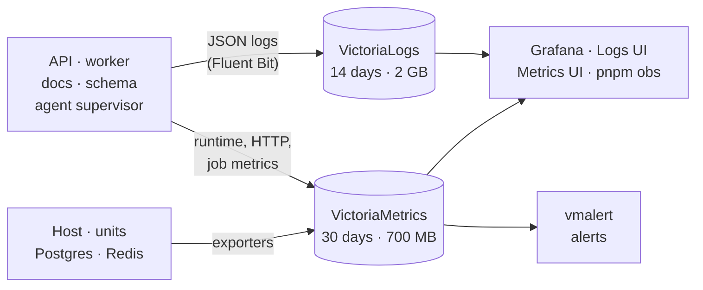

# Observability

A small, free monitoring stack runs on the VM. It is private: the UIs sit
behind the exe.dev login, and every store listens only on `127.0.0.1`.



## Where to look

| Question                              | Look at                                                     |
| ------------------------------------- | ----------------------------------------------------------- |
| Is anything wrong right now?          | `pnpm obs alerts`, then Grafana → Errors and logs           |
| How did today's edition go?           | Grafana → Product (cost, modes, picks) and Jobs             |
| Why did something fail?               | [Logs UI](/logs/select/vmui/): `service:worker level:error` |
| Is the VM short of CPU, memory, disk? | Grafana → Host and Services                                 |
| What are the queues doing?            | [Jobs browser](/queues/) (read-only)                        |
| Is the database slow?                 | Grafana → Database (top statements, slow calls)             |
| Is the agent healthy?                 | Grafana → Agent supervisor                                  |

## UIs

| UI                         | Shows                                                                                                               |
| -------------------------- | ------------------------------------------------------------------------------------------------------------------- |
| [Grafana](/grafana/)       | 10 dashboards: Host, Services, App runtime, HTTP, Jobs, Errors and logs, Product, Database, Redis, Agent supervisor |
| [Logs](/logs/select/vmui/) | Every structured log line, searchable with LogsQL                                                                   |
| [Metrics](/metrics/vmui/)  | Raw metric queries (PromQL)                                                                                         |
| [Jobs](/queues/)           | BullMQ queues, schedules and retained runs; no retry or delete buttons                                              |

Dashboards are defined in `ops/observability/grafana/` and can't be edited in
the UI. Empty panels mean "nothing observed", not "zero".

## What is collected

| Kind         | What                                                                                                                                                                                                              |
| ------------ | ----------------------------------------------------------------------------------------------------------------------------------------------------------------------------------------------------------------- |
| Logs         | HTTP requests, job runs, every external call (feeds, HN, X, Anthropic, xAI, Bluesky), AI and X budget decisions, rejected AI output, edition stages, errors with stacks, browser errors, DB calls ≥ 250 ms        |
| Metrics      | Host and per-unit resources, Node runtime, HTTP rate and latency per route, external calls per target, job durations, queue states, Postgres and Redis stats, top statements, spend against caps, agent heartbeat |
| Product data | Grafana reads Postgres directly through a read-only login: editions, spend, sources, social picks                                                                                                                 |

- **Correlated:** each request returns an `X-Request-Id`, and job, run and
  edition IDs are carried on every related line. For example,
  `pnpm obs logs --edition <id>` shows one edition's whole run.
- **Private by design:** logs and metrics never hold secrets, prompts, AI
  responses, article text, URLs or SQL. Redaction is tested.

## Alerts

vmalert evaluates every 30 s. Nothing is emailed: alerts show in
`pnpm obs alerts`, which the agent runs at the start of every iteration.

| Alert             | Fires when                                                                                                       |
| ----------------- | ---------------------------------------------------------------------------------------------------------------- |
| Disk              | Any filesystem is over 80% for 2 min                                                                             |
| Memory            | Host has under 10% free for 5 min, or an `obs-*` service is over 90% of its limit                                |
| Service down      | A monitored unit is inactive, or a scrape fails, for 2 min                                                       |
| Errors            | API 5xx over 5% (with at least 20 requests in 5 min), or new worker job failures                                 |
| Scheduled edition | The digest scheduler is missing, paused or stalled, or a due run isn't recorded or settled 15 min after its time |
| Spend             | Anthropic or xAI reaches 90% of a daily or monthly cap                                                           |

## Command line

Run these on the VM, from the repo:

```sh
pnpm obs alerts                                  # pending and firing alerts
pnpm obs health                                  # also: services, sources, targets; add --check for an exit code
pnpm obs errors --since 1h
pnpm obs logs --service worker --since 1h        # also: --edition, --queue/--job, --grep
pnpm obs jobs --queue digest-generation --state failed
pnpm obs metric 'up' --since 1h --step 60s
```

## Resources and operations

- **Units:** `obs-*` system units, each with a memory and CPU cap:
  Grafana 256 MB, logs 160 MB, metrics 112 MB, everything else 80 MB or
  less, and 0.5–3% of a core each.
  - Memory reclaim starts at 88 MB for metrics and 128 MB for logs.
  - They run at low priority, so they lose contention to the app.
  - They sit outside the app's health gate.
  - Measured use is about 0.5 GB of RAM in total, under 1% CPU.
- **Install or reconcile:** run `ops/observability/install*.sh`.
  - Releases are pinned and SHA-256 checked.
  - The installers never restart the app, Postgres or Redis. The one
    exception is the first query-statistics install, which waits for a
    safe window.
- **Check:** `systemctl status 'obs-*'`, and
  `pnpm exec tsx scripts/check-observability.ts` for a full read-only check.
  Flags like `--verify-grafana` and `--verify-alerts` check one area.
- **If the API is down,** the UIs are down too, because the API forwards
  them. Use an SSH tunnel instead, for example
  `ssh -L 3001:localhost:3001 news-digest.exe.xyz`, then open
  `localhost:3001/grafana/`. The other ports are 9428 (logs) and 8428
  (metrics).

Background: [observability plan](../../observability-plan.md) and
[capacity decision](../../decisions/0004-observability-capacity.md).
