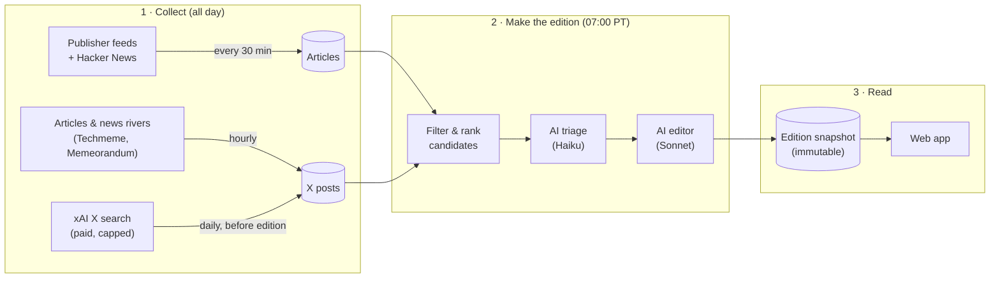

# The app

Every morning the app publishes an **edition**: for each topic (Tech & AI,
NBA, Gaming, World news), a short brief, the top stories and the most
interesting social posts. You can also create an edition on demand for any
time window.

## Key ideas

- **Topics are configuration, not code.** Each topic has guidance, sources,
  story/post budgets and X accounts, all editable in the app's settings.
- **Editions are immutable snapshots.** An edition copies everything it shows
  into one JSON record, so old editions never change when sources or
  settings do.
- **AI is optional and capped.** If the AI budget runs out, the edition still
  publishes using non-AI ranking, and the page says so.
- **NBA reporting** includes CBS, Yahoo, Hoops Rumors, RealGM Basketball,
  SB Nation NBA, Basketball Insiders and Yardbarker NBA. SB Nation also supplies embedded X
  highlight links for free discovery; posts still need official embed verification.
  RealGM also carries other basketball leagues; topic ranking filters relevance.
  Yardbarker includes syndicated reports. Multiple publishers may repeat the
  same original report.
- **Every external call goes through a port.** Feeds, AI, X and queues sit
  behind interfaces, so tests use fakes and never touch live services.

## Pages in this section

1. [Stack & runtime](01-stack-and-runtime.md): the tech and where it runs
2. [Code structure](02-code-structure.md): how the repo is organized
3. [Jobs & schedules](03-jobs-and-schedules.md): what runs when
4. [Edition pipeline](04-edition-pipeline.md): how an edition is made
5. [Social posts](05-social-posts.md): how X posts are found and verified
6. [AI & budgets](06-ai-and-budgets.md): models, caps and spending rules
7. [Data model](07-data-model.md): the database at a glance
8. [Operations](08-operations.md): URLs, health, logs, tests
9. [Observability](09-observability.md): structured request, job and error logs
