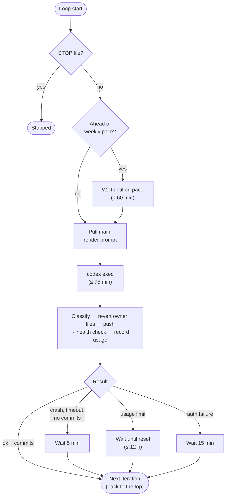

# Iteration loop

The supervisor (`ops/agent-control/run.sh`, with helpers in `control.py`) is a
plain Bash loop. One pass is one **iteration**: a single Codex session, with a
75-minute timeout. During every wait, the STOP file is checked every 5 seconds.

## What goes into each prompt

The prompt is rendered from `ops/agent-control/ITERATION_PROMPT.md`:

| Part                     | Content                                                                                |
| ------------------------ | -------------------------------------------------------------------------------------- |
| Fixed instructions       | Orient cheaply, fix broken things first, do one verified step, commit, push, summarize |
| `{{N}}`, start, deadline | Iteration number and run timing                                                        |
| `{{BUDGET}}`             | One line: weekly quota used vs. share of the week elapsed, and whether to economize    |
| `{{LAST_SUMMARY}}`       | The previous iteration's final message (≤ 10 lines)                                    |

Codex also loads `AGENTS.md` (repo root) automatically as standing
instructions.

## How a result is classified

`control.py classify` reads Codex's JSON event stream and stderr. It looks only
at CLI errors, never at the agent's own text:

| Result    | Meaning                                  | Then                                      |
| --------- | ---------------------------------------- | ----------------------------------------- |
| `ok`      | Turn completed                           | Next iteration (5-min wait if no commits) |
| `usage`   | Codex quota exhausted                    | Wait until the reported reset (≤ 12 h)    |
| `auth`    | ChatGPT login expired or gateway refused | Retry every 15 min                        |
| `timeout` | Hit the 75-minute limit                  | Retry in 5 min; work stays on disk        |
| `crash`   | Anything else                            | Retry in 5 min                            |

## Files it produces (on the VM, in `~/agent-control/`)

| Path                          | What                                                    |
| ----------------------------- | ------------------------------------------------------- |
| `status/heartbeat.json`       | Live state: iteration, state, next retry, health, usage |
| `status/usage.json`           | Latest Codex quota snapshot                             |
| `logs/supervisor.log`         | One line per event                                      |
| `logs/iter-NNN.prompt.md`     | Exact prompt sent                                       |
| `logs/iter-NNN.jsonl`, `.err` | Codex event stream and stderr                           |
| `logs/iter-NNN.final.md`      | The agent's final summary (fed to the next iteration)   |
| `logs/usage.tsv`              | Tokens and quota % per iteration                        |
