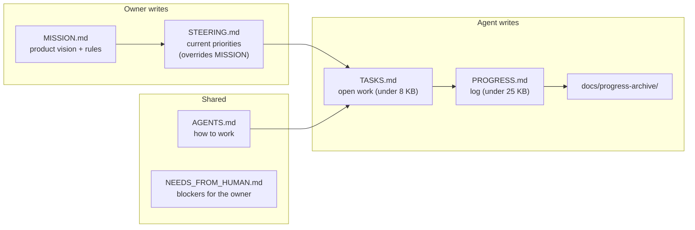
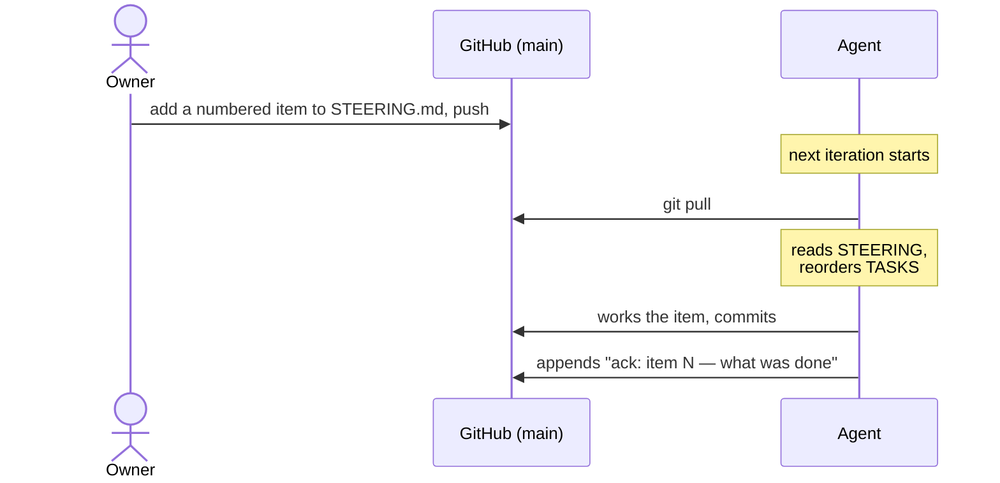

# Steering & memory

The agent has no memory between iterations except **files in the repo**. They
form a hierarchy: the owner sets direction, and the agent keeps its own plan
and log.

The agent's only write to `STEERING.md` is appending `ack:` lines.

## Who edits what

| File                  | Owner      | Agent                            | Read every iteration?   |
| --------------------- | ---------- | -------------------------------- | ----------------------- |
| `MISSION.md`          | ✏️ writes  | 🚫 never (supervisor reverts it) | Only relevant sections  |
| `STEERING.md`         | ✏️ writes  | Appends `ack:` lines only        | ✅ Yes                  |
| `AGENTS.md`           | ✏️ writes  | Rarely, for workflow facts       | ✅ Auto-loaded by Codex |
| `TASKS.md`            | Reads      | ✏️ maintains                     | ✅ Open items           |
| `PROGRESS.md`         | Reads      | ✏️ appends, archives old entries | ✅ Last ~30 lines       |
| `NEEDS_FROM_HUMAN.md` | Acts on it | ✏️ writes requests               | When relevant           |
| `docs/decisions/`     | Reads      | ✏️ records decisions             | When relevant           |

## How to steer the agent

Tips for good steering items:

- **Number them** and state priority explicitly ("TOP PRIORITY", "LOWER",
  "after item 16"), plus a **"Done when"** line.
- **Say what not to do** too ("not now: email delivery"). The agent follows
  exclusions reliably.
- **Archive finished items** to `docs/steering-archive.md`, so every iteration
  reads less.
- Changes take effect at the **next iteration** (usually within minutes). The
  running iteration is never interrupted.
