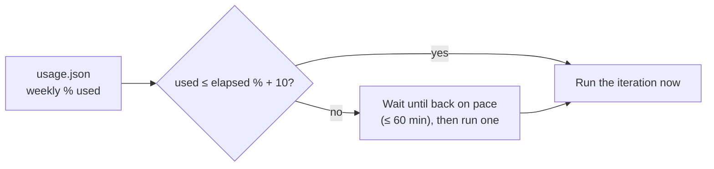

# Usage & pacing

The agent's model calls come out of the owner's **ChatGPT Pro** subscription
through the exe.dev gateway. Pro has a **weekly** allowance (no 5-hour
window). If it runs out, the agent stalls until the week resets. Two
mechanisms prevent that.

## 1 · Pacing (hard, in the supervisor)

Before each iteration the supervisor compares quota used with the share of
the week that has passed:

- **Effect:** the week's work is spread evenly instead of burned in a burst.
  It never reduces the total. It only changes timing.
- **Never halts:** after a pacing wait, one iteration always runs, which also
  refreshes the usage snapshot.
- **Settings** (in the systemd unit): `PACE_WEEKLY=1`, `PACE_SLACK_PCT=10`,
  `PACE_MAX_WAIT_MIN=60`.

## 2 · Token efficiency (soft, in the instructions)

`AGENTS.md` → "Token efficiency" tells the agent to:

- **cap command output** (`head`, `tail`, `jq` fields), because everything
  printed is re-sent on every later step;
- **read narrowly** (`rg` + line ranges), and never re-read a file;
- **run tests quietly** while developing, then once fully before committing;
- **keep `TASKS.md` and `PROGRESS.md` small**, since they're read every iteration.

It must **never trade correctness for tokens**: verification is never skipped.
Each prompt's `{{BUDGET}}` line says whether the agent is on pace. When it's
ahead, the agent is told to take smaller steps.

## Where to look

| What                         | Where (VM)                                        |
| ---------------------------- | ------------------------------------------------- |
| Current quota snapshot       | `~/agent-control/status/usage.json`               |
| Tokens + quota per iteration | `~/agent-control/logs/usage.tsv`                  |
| Pacing waits                 | `grep Pacing ~/agent-control/logs/supervisor.log` |

Typical iteration: ~1M input tokens (over 90% cached), ~6k output.
