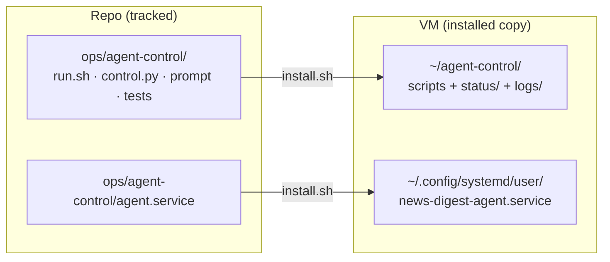

# Agent operations

All commands run on the VM (`ssh news-digest.exe.xyz`).

## Is it working?

```bash
cat ~/agent-control/status/heartbeat.json      # state, iteration, health, usage
tail -20 ~/agent-control/logs/supervisor.log   # recent events
git -C ~/news-digest log --oneline -10         # what it shipped
tail -40 ~/news-digest/PROGRESS.md             # what it says it did
```

`heartbeat.json → state` is one of `running`, `preparing`, `retry_wait`,
`usage_wait`, `pace_wait` or `stopped`.

## Start, stop, restart

```bash
touch ~/agent-control/STOP                          # graceful: finish current iteration, then stop
bash ~/agent-control/stop-now.sh                    # immediate: kill it now
rm -f ~/agent-control/STOP
systemctl --user start news-digest-agent.service    # start again
```

STOP persists across reboots until removed. None of these touch the app's
own services.

## Where things live



The agent may **not** modify `~/agent-control/`. To change the harness:

1. Edit `ops/agent-control/` in the repo.
2. Run its tests: `python3 ops/agent-control/verify.py` (fake Codex, no
   quota used).
3. Reinstall with `bash ops/agent-control/install.sh`. It refuses while an
   iteration holds the lock, so stop first. `control.py` alone can be swapped
   atomically while the agent runs.

## Common situations

| Symptom                                    | Likely cause           | Fix                                                 |
| ------------------------------------------ | ---------------------- | --------------------------------------------------- |
| `result=auth` repeating                    | ChatGPT login expired  | `ssh exe.dev integrations setup chatgpt`            |
| `state=usage_wait`                         | Weekly quota exhausted | Wait for the reset (time in `usage.json`)           |
| `state=pace_wait`                          | Ahead of weekly pace   | Normal; it self-corrects within an hour             |
| Many `no_progress` iterations              | Blocked or confused    | Read `PROGRESS.md` and `NEEDS_FROM_HUMAN.md`; steer |
| Health shows a failed `news-digest-*` unit | App service crashed    | The agent fixes it next iteration, or restart it    |
