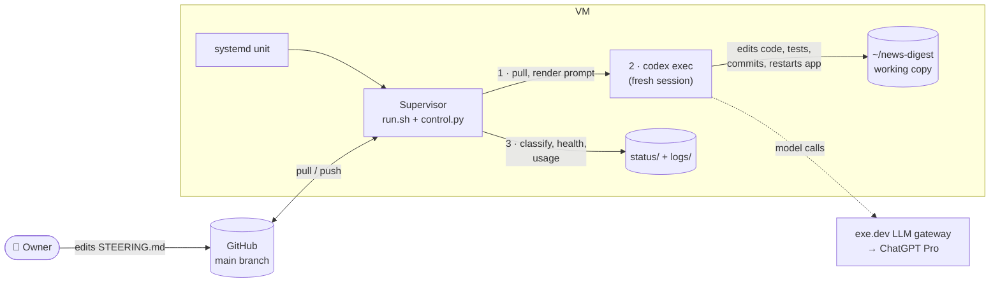

# The agent factory

The app is built by an **autonomous coding agent** (OpenAI Codex CLI) running
in a loop on the same VM, around the clock. A small supervisor script restarts
it for every unit of work and keeps it within quota. It retries forever and
never needs a human to unblock it. The owner steers it by editing files in the
repo.

## The big ideas

- **No long-lived chat.** Each iteration is a **fresh** Codex session. All
  memory lives in repo files and git history (see
  [Steering & memory](02-steering-and-memory.md)).
- **One step per iteration.** The agent orients itself, does one verified
  step, commits, pushes and writes a short summary. The next iteration
  starts from that summary.
- **Never give up.** Crashes, timeouts, quota and login failures all lead to
  a wait and a retry, never a stop. Only the owner stops it.
- **Owner files are protected.** The agent may not edit `MISSION.md` or
  `BOOTSTRAP.md`. In `STEERING.md` it only appends `ack:` lines. The
  supervisor reverts any change to the protected files.
- **Quota-aware.** The supervisor paces iterations against the weekly Codex
  allowance (see [Usage & pacing](03-usage-and-pacing.md)).

## Pages in this section

1. [Iteration loop](01-iteration-loop.md): what the supervisor does each cycle
2. [Steering & memory](02-steering-and-memory.md): the repo files that drive the agent
3. [Usage & pacing](03-usage-and-pacing.md): staying within the Codex quota
4. [Operations](04-operations.md): start, stop, monitor, change the harness
