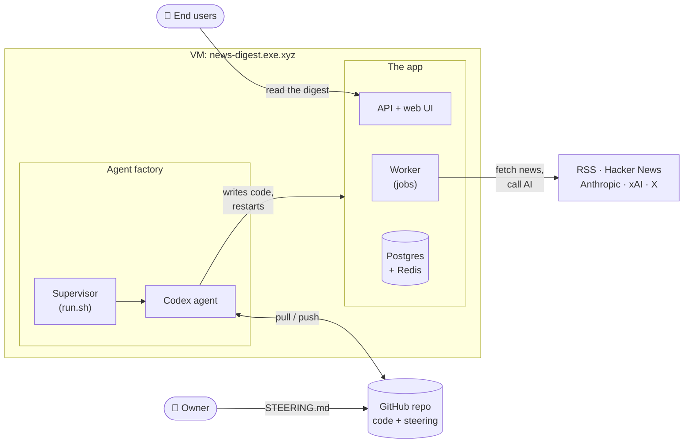

# news-digest handbook

How the system works, at the level of boxes and arrows rather than functions.
There are two parts:

- **The app:** a daily digest of articles and social posts per topic.
- **The agent factory:** the autonomous coding agent that builds and runs the
  app.

## Start here

| If you want to…                         | Read                                                    |
| --------------------------------------- | ------------------------------------------------------- |
| Understand what the app does end to end | [The app](01-app/README.md)                             |
| See the tech and where it runs          | [Stack & runtime](01-app/01-stack-and-runtime.md)       |
| Understand how an edition is made       | [Edition pipeline](01-app/04-edition-pipeline.md)       |
| Understand the database                 | [Data model](01-app/07-data-model.md)                   |
| Understand the autonomous agent         | [The agent factory](02-agent/README.md)                 |
| Steer the agent                         | [Steering & memory](02-agent/02-steering-and-memory.md) |

## Tools

| Tool       | URL                               | What it is                                                  |
| ---------- | --------------------------------- | ----------------------------------------------------------- |
| App        | https://news-digest.exe.xyz/      | The digest itself, settings and the Status page             |
| These docs | https://news-digest.exe.xyz/docs/ | Owner handbook in private mode; reader guide in public mode |
| DB schema  | https://news-digest.exe.xyz/db/   | Live, interactive diagram of the database                   |

All three need an exe.dev login, because the VM is private. The docs also
render on GitHub, since they're plain Markdown + Mermaid.

> [!NOTE]
> These docs explain the system, not the code. For the reasoning behind
> decisions see [`docs/decisions/`](../decisions/). For deep reference notes
> written by the agent see [`docs/`](../).
> [About these docs](about-these-docs.md) describes the conventions.
