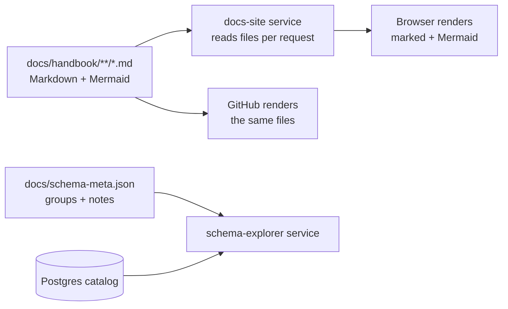

# About these docs

How the handbook is built and the conventions every page follows. This is a
draft for the owner to review. Once agreed, the build agent will be told to
maintain the docs to these rules.

## How it works

- **No build step.** Edit a `.md` file, commit and pull, and the page updates
  on the next reload.
- **Navigation is the folder structure:** `NN-section/README.md` is a section's
  overview (its `#` title names the section), and `NN-page.md` files are
  ordered by number.
- **The DB explorer is generated** from the live database. Only grouping,
  short notes and relations without a foreign key are written by hand, in
  `docs/schema-meta.json`. Tables it doesn't mention show up as "Unassigned",
  and stale entries show up as warnings.

## Style rules

| Rule                       | Meaning                                                                                |
| -------------------------- | -------------------------------------------------------------------------------------- |
| **System, not code**       | Explain what parts exist, what they do and how they connect. No function-level detail. |
| **Diagram first**          | Most pages open with a diagram. Prose explains what the diagram can't.                 |
| **Short**                  | Aim for about one screen of text per page. Split pages rather than grow them.          |
| **Tables over paragraphs** | Use a table for comparisons, inventories and "who does what".                          |
| **Plain words**            | Write for a technical reader who doesn't read the code. Define a term once.            |
| **Current state**          | Describe how things are now. Plans go in short `[!NOTE]` callouts linking to STEERING. |
| **No duplication**         | Link to the schema explorer, `docs/decisions/` or other pages instead of copying.      |

## Diagram toolkit (Mermaid)

| Use                      | Mermaid type      | Example page                                        |
| ------------------------ | ----------------- | --------------------------------------------------- |
| Components and data flow | `flowchart`       | [Stack & runtime](01-app/01-stack-and-runtime.md)   |
| Interactions over time   | `sequenceDiagram` | [Jobs & schedules](01-app/03-jobs-and-schedules.md) |
| Lifecycles and states    | `stateDiagram-v2` | [Iteration loop](02-agent/01-iteration-loop.md)     |
| Entities and relations   | `erDiagram`       | [Data model](01-app/07-data-model.md)               |
| Timelines                | `gantt`           | [Jobs & schedules](01-app/03-jobs-and-schedules.md) |

### Diagram checklist

The viewer lays diagrams out with the ELK engine. Before committing a diagram,
look at it rendered and check that:

- **no line crosses another line, a box, or a box's title;**
- **boxes with titles flow left-to-right** (`flowchart LR`), because arrows
  entering a box from the top run through its title;
- **sequence diagrams have no self-messages** (use `Note over X:`), and
  participants are ordered so no arrow crosses a lifeline it doesn't use;
- **Gantt labels contain no colons** (Mermaid cuts the label at a colon).

Inline SVG is allowed for the rare diagram Mermaid can't express. Callouts use
GitHub syntax: `> [!NOTE]`, `> [!TIP]`, `> [!IMPORTANT]`, `> [!WARNING]`.

## When a page must be updated (proposed agent rule)

- Updating a page is **part of the change** that makes it wrong: a new service,
  queue, external system, table group, budget rule or harness behavior.
- New tables get a group and a one-line note in `docs/schema-meta.json`.
- Bug fixes and internal refactors usually need **no** doc change.
